<p align="center">
  
</p>

<h1 align="center">lvd RF cad</h1>

<p align="center">
  <b>RF system and circuit design, SPICE simulation and antenna array design in one open-source desktop application.</b><br>
  Free, GPL-3.0, Windows · current release <b>0.5.0</b>
</p>

<p align="center">
  <a href="#features">Features</a> ·
  <a href="#screenshots">Screenshots</a> ·
  <a href="#how-it-compares">Comparison</a> ·
  <a href="#getting-started">Getting started</a> ·
  <a href="docs/manual/manual.md">User manual</a> ·
  <a href="#building-from-source">Building</a>
</p>

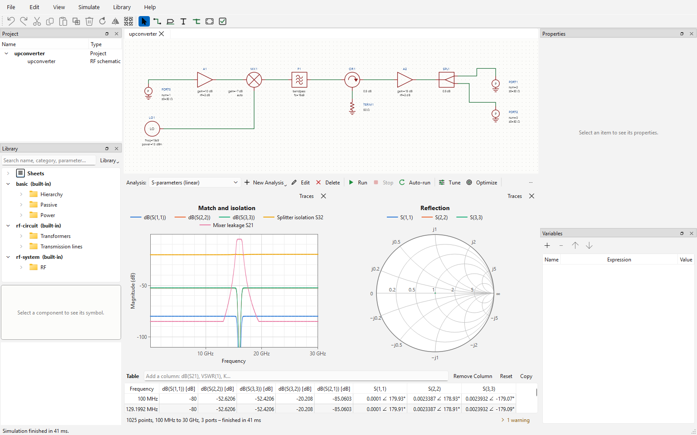

RF engineers usually juggle several tools: one for the system budget, one for linear circuit simulation, a SPICE simulator for the bias network, a spreadsheet for the array, and a script for everything in between. **lvd RF cad** puts these in one project, with one schematic editor, one component library and one Python API. A receiver budget can feed the T/R module of an AESA. A matching network can be synthesised and dropped into the schematic you are simulating. Every analysis can be scripted.

## Features

### RF system design
- **Budget cascade** per stage and cumulative: gain, noise figure, IP3, P1dB, IP2, signal, noise and SNR, SFDR, compression headroom. Mismatch between stages comes from the real S-parameters.
- **Frequency plan** with automatic signal and LO tracing through mixers, multipliers, splitters, couplers, switches and diplexers.
- **Mixer spur analysis**: m×n products, spurious responses, image, half-IF and LO leakage, from spur tables or an estimate.
- **LO phase noise**: integrated phase error and jitter, the SNR limit after each mixer, and reciprocal mixing with a blocker. VCO and PLL blocks are described with data-sheet numbers.
- **Converters**: ADC headroom, quantisation SNR and aliasing; DAC sinc roll-off, noise density and images.
- Swept budgets, level diagram, and **36 behavioural blocks**: amplifiers, mixers, filters, hybrids, baluns, switches, limiters, detectors and more. Each block can have return loss and frequency slopes.

### RF circuit simulation
- **S-parameter and noise analysis** of hierarchical schematics:
  - lumped R, L and C with ESR, ESL and parasitic capacitance, plus 0201–0805 package parts;
  - ideal and physical transmission lines (microstrip, stripline, coax, CPW, coupled microstrip);
  - microstrip discontinuities (open end, gap, step, bend, tee, via);
  - Touchstone N-ports.
- **Substrate catalog** of 12 common board materials (FR-4, Rogers, Taconic, alumina, …). One Substrate part on the sheet drives every line, with conductor roughness included.
- **Results**:
  - rectangular plots, Smith charts and tables, with markers;
  - stability, gain and noise-figure circles;
  - K, μ, MAG, Mason's U, noise parameters and group delay.
- **Design aids**:
  - matching-network synthesis (L, Pi, T, ladders, stubs, quarter-wave) inserted straight into the schematic;
  - live tuning sliders;
  - an optimiser (Nelder–Mead, Levenberg–Marquardt) with snapping to E-series values.
- **S-parameter editor**: renormalise, renumber, resample, cascade, de-embed, and check passivity and reciprocity. Touchstone 1 and 2.
- Network maths and line models are checked against [scikit-rf](https://scikit-rf.org/) in the test suite.

### SPICE simulation
- **ngspice 47 embedded**: operating point, DC, AC, transient, noise, Fourier (THD), transfer function, pole-zero, sensitivity.
- **Waveform viewer** with cursors, measurements and FFT. The operating point is shown on the schematic.
- **Virtual instruments**: oscilloscope, voltmeter, ammeter, function generator, spectrum analyser, Bode plotter.
- **Parameter and temperature sweeps, Monte Carlo, worst case and optimisation**, run in parallel worker processes.
- An 88-part SPICE library. Vendor `.lib`, `.mod` and `.subckt` models can be imported as library parts, existing netlists can be imported, and models can be written in Python.

### Antennas and arrays
- **Array designer**: linear, planar (rectangular or triangular lattice), circular, conformal and custom arrays.
- **Tapers and beams**: Taylor, Chebyshev and custom tapers; phase or true-time-delay steering; sub-arrays, multiple beams, nulls and monopulse.
- **AESA effects**: phase-shifter and attenuator quantisation, amplitude and phase errors, failed elements, each compared with the ideal array.
- **Pattern views**: cuts, UV map with grating lobes, and a 3D view; scan and band sweeps; pattern synthesis to a side-lobe mask.
- **System figures**: T/R modules linked live to RF schematic budgets, giving EIRP, G/T and system temperature against scan angle.
- **Element models**: analytic elements, or measured patterns imported from CSV, CST and FEKO files.
- **Full-wave elements** with the bundled [openEMS](https://openems.de/) FDTD solver.
  - Parametric templates: patches, dipole, monopole, PCB inverted-F, slot, horn, Vivaldi and helix.
  - STL import and embedded element patterns.
  - Checked against the openEMS tutorials.

### Platform
- **Projects** hold RF, SPICE and antenna documents in versioned JSON, friendly to version control.
- **Schematic editor**: hierarchy, variables and expressions with SI prefixes (`2.4GHz`, `4n7`, `f_rf - f_if`), rule check, symbol editor and library manager.
- **Embedded Python 3** console, and a command-line runner for scripts with no GUI ([Python API](docs/python-api.md)).
- **Safety and output**: autosave with crash recovery; printing and PDF, SVG and PNG export with a title block.

## Screenshots

| | |
|:---:|:---:|
| 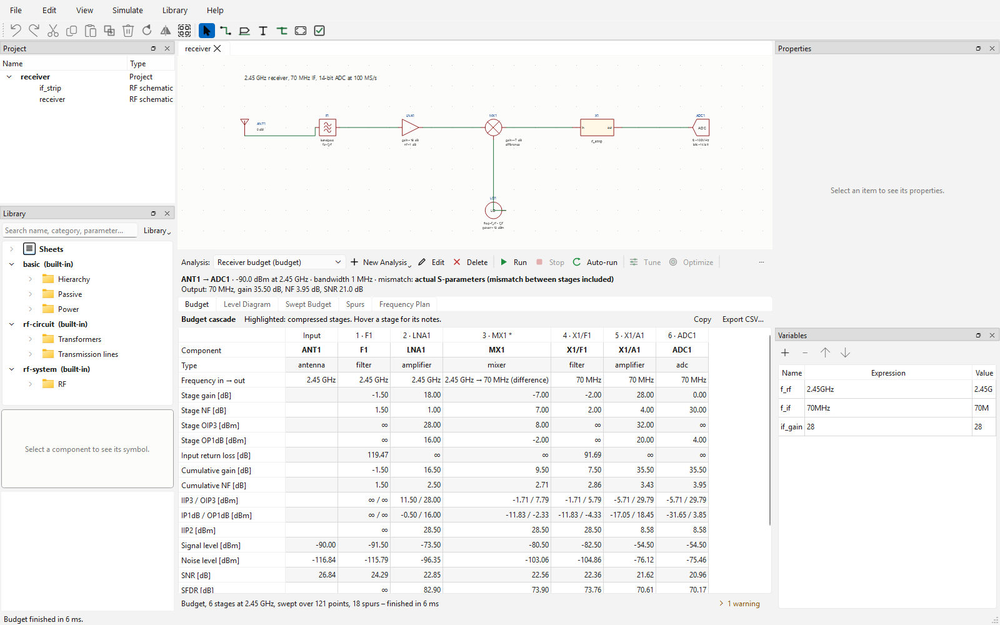 | 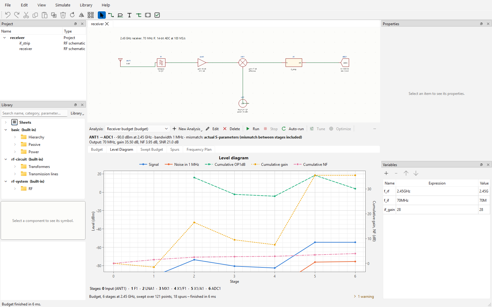 |
| Receiver budget cascade | Level diagram |
| 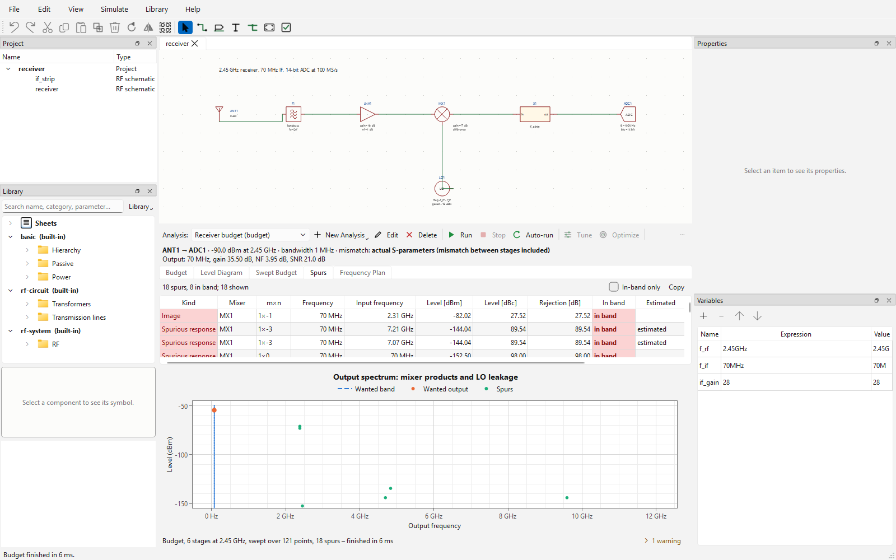 | 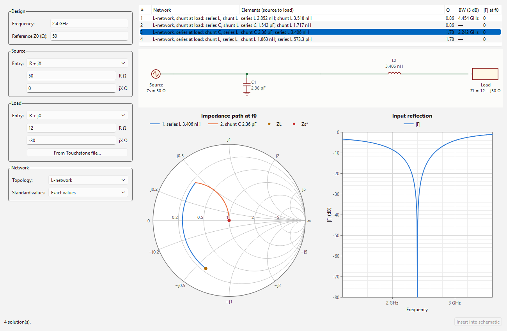 |
| Mixer spur analysis | Matching-network synthesis |
| 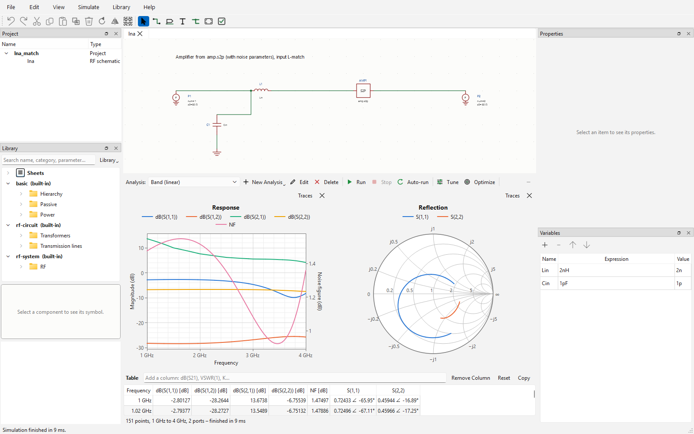 | 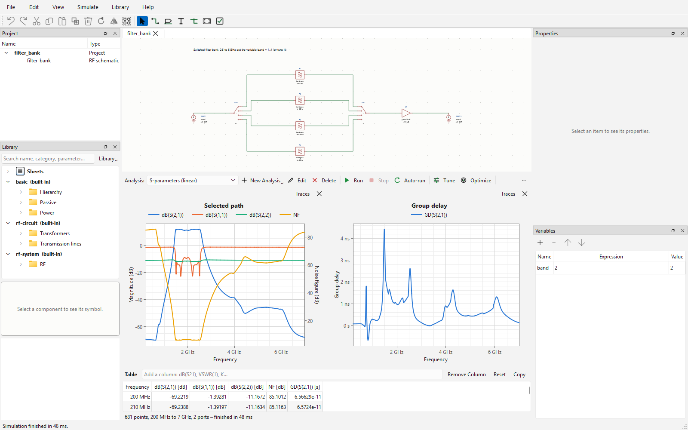 |
| LNA match: S-parameters and noise | Switched filter bank, one variable selects the path |
| 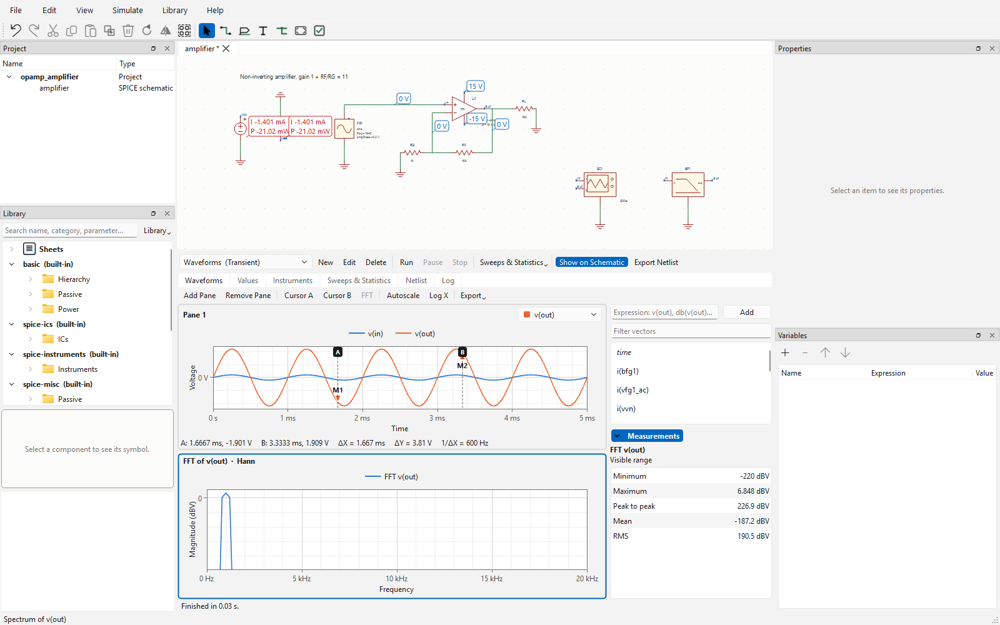 | 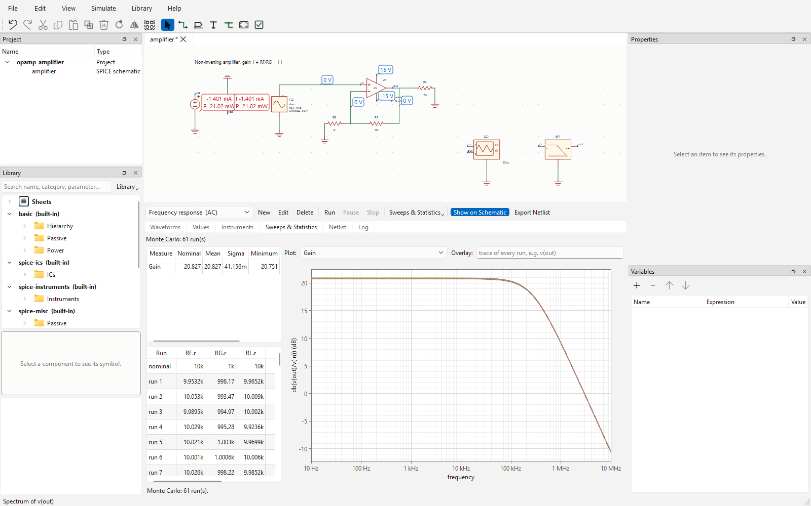 |
| SPICE transient waveforms | Monte Carlo analysis |
| 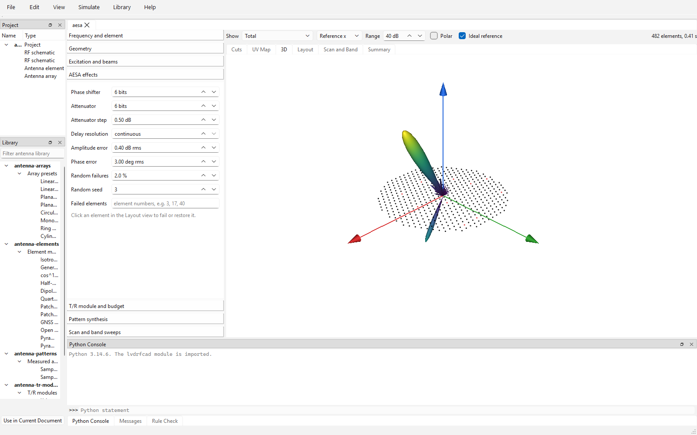 | 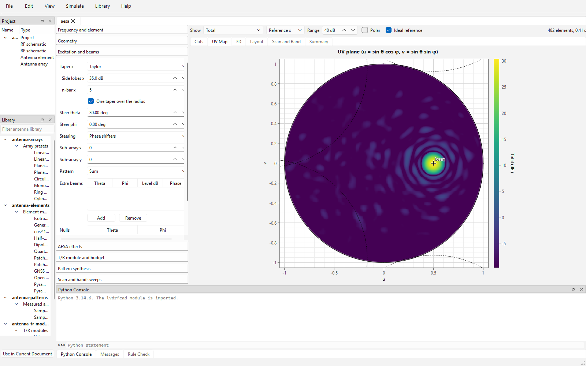 |
| AESA with quantisation and failures, 3D pattern | UV map with grating-lobe circles |
| 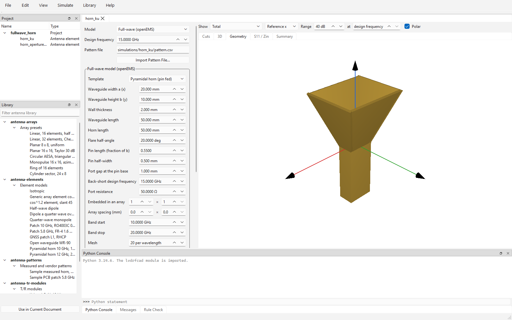 | 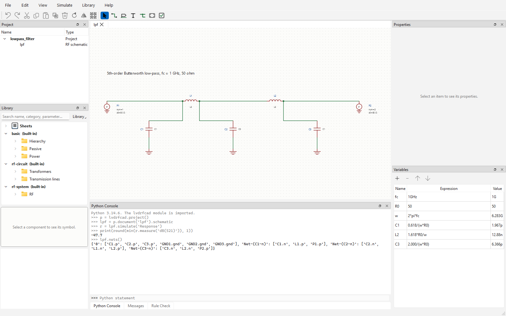 |
| Full-wave horn (openEMS) | Python scripting |

## How it compares

lvd RF cad is not a replacement for a full commercial RF suite. It covers the everyday system-to-circuit-to-antenna workflow in one free tool. The table compares what each tool provides out of the box.

| | **lvd RF cad** | Commercial alternative 1 | Commercial alternative 2 | Commercial alternative 3 | Qucs-S | LTspice |
|---|:---:|:---:|:---:|:---:|:---:|:---:|
| Licence | **GPL-3.0, free** | Commercial | Commercial | Commercial | GPL, free | Freeware |
| Linear S-parameter and noise simulation | ✅ | ✅ | ✅ | ✅ | ✅ | ➖ |
| RF system budget (cascade, frequency plan) | ✅ | ✅ | ✅ | ✅ | ❌ | ❌ |
| Mixer spur analysis | ✅ | ✅ | ✅ | ✅ | ❌ | ❌ |
| LO phase noise and reciprocal mixing in the budget | ✅ | ✅ | ✅ | ✅ | ❌ | ❌ |
| SPICE-class transient, AC and noise | ✅ (ngspice) | ✅ | ✅ | ➖ | ✅ (ngspice, Xyce) | ✅ |
| Monte Carlo, worst case, sweeps | ✅ | ✅ | ✅ | ✅ | ➖ | ✅ |
| Harmonic balance (nonlinear RF circuits) | ❌ | ✅ | ✅ | ➖ | ➖ | ❌ |
| Matching-network synthesis | ✅ | ✅ | ✅ | ✅ | ✅ | ❌ |
| Tuning and goal optimisation | ✅ | ✅ | ✅ | ✅ | ➖ | ❌ |
| Physical lines, substrates, microstrip discontinuities | ✅ | ✅ | ✅ | ✅ | ✅ | ❌ |
| Phased-array / AESA design | ✅ | ➖ | ✅ | ✅ | ❌ | ❌ |
| Full-wave EM | ✅ antennas (openEMS FDTD) | ✅ | ✅ | ❌ | ❌ | ❌ |
| PCB layout and layout-driven EM | ❌ | ✅ | ✅ | ❌ | ❌ | ❌ |
| Built-in Python scripting | ✅ | ✅ | ➖ | ➖ | ❌ | ❌ |
| Plain-text project files (JSON for lvd RF cad) | ✅ | ❌ | ❌ | ❌ | ✅ | ✅ |
| Platforms | Windows | Windows, Linux | Windows | Windows | Windows, Linux, macOS | Windows, macOS |

✅ built in · ➖ partial, limited or through an add-on · ❌ not available

*Commercial alternatives 1 to 3* stand for typical commercial RF design suites: two integrated circuit-and-EM design environments and one system-level design tool. They are licensed in bundles, so some features need extra modules. The table is a best-effort summary of publicly documented features as of late 2026; corrections are welcome. LTspice is a trademark of Analog Devices, Inc.; other names are trademarks of their respective owners, and no affiliation or endorsement is implied.

**Where lvd RF cad is the right tool:**
- system architecture and link budgets;
- linear RF circuit design, matching and tuning;
- bias and baseband circuits in SPICE;
- antenna arrays and their T/R chains, kept in one project and scriptable from Python.

**Where you still need a commercial suite:**
- nonlinear RF circuit simulation (harmonic balance, load-pull);
- PCB or MMIC layout with EM co-simulation;
- foundry PDKs;
- full-wave simulation of arbitrary 3D structures.

## Getting started

1. **Download** the installer (`lvdRFcad-0.5.0-setup.exe`) or the portable ZIP (`lvdRFcad-0.5.0-win64.zip`). The ZIP needs no installation: unpack it and run `lvdrfcad.exe`.
2. **Open an example** with *Help > Open Examples Folder*. There are 20 example projects, including:
   - a superheterodyne receiver;
   - up- and down-converters;
   - a PLL receiver;
   - a switched filter bank and an AGC module;
   - an LNA match;
   - op-amp and BJT circuits;
   - an X-band AESA;
   - a Ku-band satcom panel;
   - full-wave patch and horn antennas.
3. **Read the [user manual](docs/manual/manual.md).** It walks through every example step by step.

Script it from the built-in console or from the command line:

```python
import lvdrfcad

project = lvdrfcad.open_project("examples/receiver/receiver.lvdproj")
rx = project.document("receiver").schematic
budget = rx.budget("Receiver budget")
last = budget["stages"][-1]
print(f"gain {last['cumulative_gain']:.1f} dB, NF {last['cumulative_nf']:.2f} dB, SNR {last['snr']:.1f} dB")
```

```powershell
lvdrfcad-cli.exe my_script.py
```

## Documentation

| Document | Content |
|---|---|
| [User manual](docs/manual/manual.md) | Every feature, with worked examples and troubleshooting |
| [Python API](docs/python-api.md) | The `lvdrfcad` module |
| [Component libraries](docs/libraries.md) | Every built-in part, its parameters and its model equations with references |
| [File formats](docs/file-format.md) | Project, document, library and analysis formats |

## Building from source

Requirements:
- Visual Studio 2022 with the C++ workload;
- CMake 3.24 or newer;
- Qt 6.5 or newer (MSVC 2022 64-bit kit);
- Python 3.10 or newer, installed with its development files and on `PATH`.

CMake downloads pybind11, Catch2, Eigen, ngspice 47, openEMS 0.37.0 and HDF5 during configuration.

```powershell
$env:QT_ROOT = 'C:/Qt/6.11.1/msvc2022_64'   # your Qt kit folder
cmake --preset windows
cmake --build --preset windows
ctest --preset windows        # all but the long full-wave template runs
ctest --preset windows-all    # everything (about 15 more minutes, 4 GB of temporary disk)
```

The binaries are in `build/bin/RelWithDebInfo`:
- `lvdrfcad.exe` is the application.
- `lvdrfcad-cli.exe` runs Python scripts without the GUI.

Packages:

```powershell
cmake --build --preset windows --target portable    # build/package/lvdRFcad-<version>-win64.zip
cmake --build --preset windows --target installer   # build/package/lvdRFcad-<version>-setup.exe (needs Inno Setup 6)
```

<details>
<summary><b>Source layout</b></summary>

| Folder | Content |
|---|---|
| `src/core` | Data model, libraries, expressions, connectivity, netlist, rule check (QtCore only) |
| `src/python` | Embedded interpreter and the `lvdrfcad` module |
| `src/rfdata` | Network data, Touchstone files, network operations, line and discontinuity models |
| `src/rfsim` | RF element models, linear solver with noise, budget, spurs, phase noise, measurements |
| `src/spice`, `src/spice_ui` | ngspice driver, netlister, waveforms and batches; the SPICE simulation view |
| `src/antenna`, `src/antenna_ui` | Element models, arrays, AESA effects, far-field engine, synthesis; their workspaces |
| `src/fullwave` | openEMS model, mesher, process control, result readers, templates, STL import |
| `src/plot`, `src/plot3d` | Rectangular, Smith and polar plots; OpenGL 3D view |
| `src/schematic_editor`, `src/library_ui`, `src/simulation_ui`, `src/sparam_ui`, `src/matching` | Editors and tools |
| `src/gui`, `src/app`, `src/cli` | Main window and the two executables |
| `libraries` | Built-in component, antenna and substrate libraries |
| `examples` | Example projects, generated by the scripts in `tools/` |
| `tests` | Core, schematic, GUI and Python tests; each module keeps its own tests too |

Qt keywords are disabled because they clash with the Python headers: write `Q_SIGNALS`, `Q_SLOTS` and `Q_EMIT`.
</details>

## Licence

lvd RF cad is free software under the **GNU General Public License, version 3 or later**; see [LICENSE](LICENSE). Bundled components (Qt, Python, pybind11, Eigen, ngspice, openEMS, HDF5) keep their own licences, listed in [THIRD-PARTY-NOTICES.md](THIRD-PARTY-NOTICES.md) and in *Help > About*.

<p align="center">
  Developed by <a href="http://www.lvdsystems.eu">LVD Systems</a>
</p>
