# lvd RF cad user manual

Version 0.3

lvd RF cad is a design tool for RF engineers. You draw RF and SPICE schematics, simulate S-parameters and noise, work out system budgets and mixer spurs, tune and optimise designs, synthesise matching networks and edit Touchstone files. Circuits with transistors, op-amps, regulators and logic run on the built-in SPICE simulator (ngspice), with a waveform viewer, virtual instruments, sweeps, Monte Carlo, worst-case analysis and optimisation. The antenna designer computes the patterns of elements and arrays, including AESA effects, beamforming, pattern synthesis and the EIRP and G/T of the T/R chains. Everything can also be scripted in Python.

This manual covers release 0.3: the RF editor, the SPICE simulator and the array designer. Full-wave simulation of antennas (openEMS) comes in a later release.

**Contents**

1. [Installation](#1-installation)
2. [First steps](#2-first-steps)
3. [Drawing schematics](#3-drawing-schematics)
4. [Values, variables and hierarchy](#4-values-variables-and-hierarchy)
5. [Component libraries](#5-component-libraries)
6. [S-parameter and noise simulation](#6-s-parameter-and-noise-simulation)
7. [Tuning and optimisation](#7-tuning-and-optimisation)
8. [Matching network synthesis](#8-matching-network-synthesis)
9. [S-parameter files](#9-s-parameter-files)
10. [System budget, frequency plan and spurs](#10-system-budget-frequency-plan-and-spurs)
11. [SPICE simulation](#11-spice-simulation)
12. [Virtual instruments](#12-virtual-instruments)
13. [Sweeps, Monte Carlo, worst case and optimisation](#13-sweeps-monte-carlo-worst-case-and-optimisation)
14. [SPICE models and netlists](#14-spice-models-and-netlists)
15. [Antenna elements](#15-antenna-elements)
16. [Antenna arrays](#16-antenna-arrays)
17. [Beamforming, AESA effects and synthesis](#17-beamforming-aesa-effects-and-synthesis)
18. [T/R modules, EIRP and G/T](#18-tr-modules-eirp-and-gt)
19. [Python scripting](#19-python-scripting)
20. [Examples](#20-examples)
21. [Troubleshooting](#21-troubleshooting)
22. [Keyboard and mouse reference](#22-keyboard-and-mouse-reference)

---

## 1. Installation

lvd RF cad runs on 64-bit Windows 10 and 11. Two packages are available:

| Package | Use it when |
|---|---|
| `lvdRFcad-0.3.0-setup.exe` | You want a normal installation with a Start menu entry. Project files (`.lvdproj`) then open with a double-click. The installer asks whether to install for all users (administrator rights) or only for you. |
| `lvdRFcad-0.3.0-win64.zip` | You cannot install software, or want several versions side by side. Unpack the ZIP anywhere and run `lvdrfcad.exe`. Nothing is written outside that folder except your settings. |

Both packages contain everything needed, including Python and the ngspice simulator (in the `ngspice` folder, with its licence); nothing else has to be installed. Uninstall from *Settings → Apps*, or delete the unpacked folder.

The examples used in this manual are in the `examples` folder of the installation. Copy them to your documents before working on them.

---

## 2. First steps

### 2.1 The main window

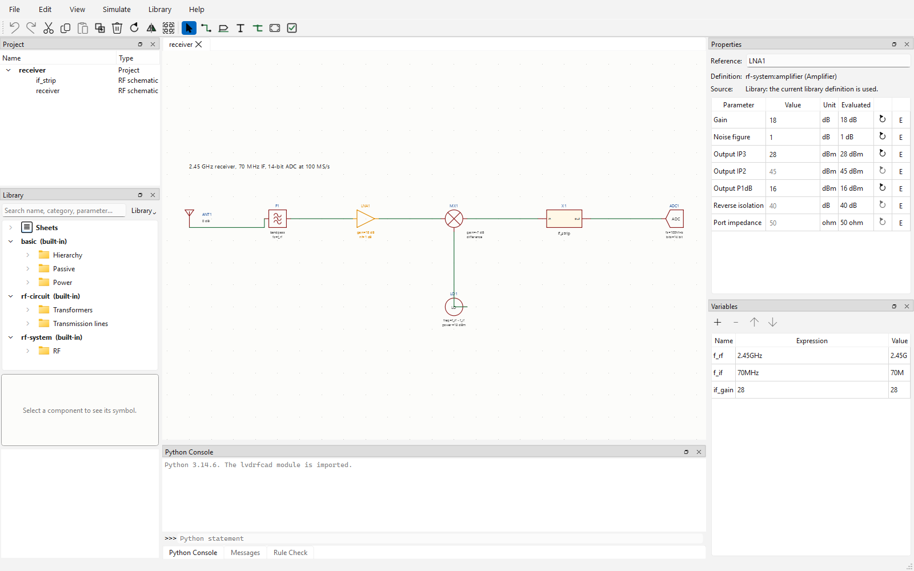

| Area | Content |
|---|---|
| Centre | One tab per open document. A schematic tab shows the editor above and its simulation results below; an antenna tab shows its settings on the left and its pattern views on the right. |
| Left | **Project**: the documents of the open project. **Library**: the components you can place, with a search box and a preview (the antenna library while an antenna document is open). |
| Right | **Properties** of the selected item, and the **Variables** of the current schematic. |
| Bottom | **Python Console**, **Messages** and **Rule Check**. |
| Toolbar | Edit actions (undo, redo, cut, copy, paste, duplicate, delete, rotate, mirror) and tools (select, wire, net label, text, net highlight, zoom to fit, rule check). |

Every panel can be moved, closed and reopened from the *View* menu. The layout is remembered.

### 2.2 Projects and documents

A **project** is a folder that holds a project file (`.lvdproj`) and its documents. Each document is a file of its own:

| Document | File | Content |
|---|---|---|
| RF schematic | `.lvdrf` | RF circuits and systems, with S-parameter, noise and budget analyses |
| SPICE schematic | `.lvdspice` | Circuits for the SPICE simulator, or an imported SPICE netlist ([chapter 11](#11-spice-simulation)) |
| Antenna array | `.lvdant` | An array: geometry, excitation, AESA effects, T/R module ([chapter 16](#16-antenna-arrays)) |
| Antenna element | `.lvdelem` | One radiator: an analytic model or an imported pattern ([chapter 15](#15-antenna-elements)) |

- *File → New Project* asks for a name and a location and creates the folder.
- *File → New Document* adds a document to the open project.
- Double-click a document in the Project panel to open it.
- *File → Save* (Ctrl+S) saves the current document; *Save All* (Ctrl+Shift+S) saves the project and every modified document. A modified document shows `*` in its tab.

All files are readable text (JSON), so projects work well with version control such as git.

### 2.3 A five-minute example

1. *File → Open Project…* and open `examples/lowpass_filter/lowpass_filter.lvdproj`.
2. Double-click **lpf** in the Project panel. The schematic is a 5th-order Butterworth low-pass filter.
3. Press **Ctrl+R** (*Simulate → Run Simulation*). The results area opens below the schematic with |S21|, |S11| and a Smith chart.
4. Double-click the **C1** variable value in the Variables panel, type `3pF`, press Enter, and run again: the filter response changes.
5. Press **Ctrl+Z** to undo.

---

## 3. Drawing schematics

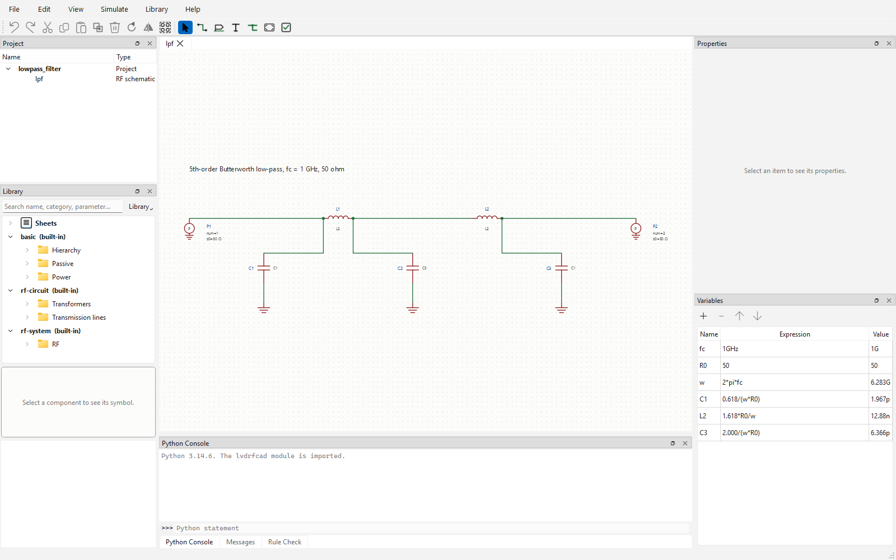

### 3.1 Placing components

- Double-click a component in the Library panel, or drag it onto the schematic. A ghost of the symbol follows the mouse.
- Click to place it. You stay in placement mode to place more copies; press **Esc** to stop.
- While placing: **R** rotates by 90°, **X** mirrors.
- New parts get the next free reference (A1, A2, …). Double-click a reference in the Properties panel to rename it.

Everything snaps to a 10-unit grid.

### 3.2 Wires, junctions and net labels

- Press **W** for the wire tool. Click to start, click to add corners, and finish with a double-click or by clicking a pin, a wire, a junction or a label. **Esc** cancels; **Backspace** removes the last corner.
- Wires are drawn with right angles. **Space** or **/** switches between horizontal-first and vertical-first.
- Wires connect where an end touches a pin, another wire or a junction. Two wires that only cross do **not** connect; the editor places a junction dot automatically where three or more connections meet.
- Press **L** for a net label. All labels with the same name are connected, which avoids long wires.
- Ground (`basic:ground`) connects its pin to the global net `0`.
- **Ctrl+click** a wire or pin to highlight its whole net; the status bar shows the net name and number of pins.

### 3.3 Editing

| Action | How |
|---|---|
| Select | Click; Shift/Ctrl+click adds; drag a rectangle (left to right: items fully inside; right to left: items touched) |
| Move | Drag the selection. Wires attached to moved pins stretch and stay at right angles. Arrow keys move by one grid step, Shift+arrow by five. |
| Rotate, mirror | **R**, **X** |
| Copy, paste, duplicate | Ctrl+C, Ctrl+V (the copy follows the mouse until you click), Ctrl+D |
| Delete | Del |
| Undo, redo | Ctrl+Z, Ctrl+Y. Every change is one undo step, including changes made from Python. |
| Zoom | Mouse wheel at the cursor; **Home** fits the whole schematic; pan with the middle button or Space+drag |

### 3.4 Properties

Select a component to edit it in the Properties panel:

- **Value** column: type a number, a value with a unit or an expression (see [4.1](#41-values-and-expressions)). Values left at the default are shown in grey; the reset button returns to the default.
- **Evaluated** column: the number the simulator will use, or the error in red.
- Choice parameters (filter type, mixer side) have a drop-down list; file parameters (S-parameter files) have a browse button.
- The **E** button rounds a value to a standard series (E12, E24, E48, E96; nearest, up or down), for example `4.5pF` to `4.7pF`.
- The **Source** line tells whether the definition comes from a library, from the copy stored in the schematic (the library was not found), or from a sub-sheet.

### 3.5 Rule check

*Rule Check* (Ctrl+E) lists errors and warnings in the Rule Check panel; double-click one to zoom to the item.

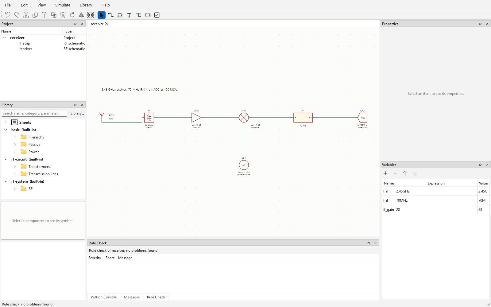

It reports unconnected pins, wires that lead nowhere, duplicate references, invalid values, several net names on one net, parts whose library is missing or changed, and problems in sub-sheets. Run it before simulating: a floating part gives results that look plausible but are wrong.

---

## 4. Values, variables and hierarchy

### 4.1 Values and expressions

Every value is stored as you type it and evaluated when needed.

| You type | Value |
|---|---|
| `2.4GHz`, `2.4 GHz`, `2.4e9` | 2.4 × 10⁹ |
| `1.2pF`, `10nH`, `50ohm`, `15dBm` | units are optional and ignored; the parameter defines the unit |
| `4n7`, `2k2`, `1M5` | 4.7n, 2.2k, 1.5M (European notation) |
| `f0/2`, `sqrt(50*100)`, `db10(2)` | expressions with variables and functions |

Prefixes are case-sensitive: `m` is milli, `M` is mega, `meg` is also mega. `K` is not kilo (300K means 300 kelvin).

Functions: `sqrt exp ln log10 sin cos tan asin acos atan atan2 sinh cosh tanh abs min max pow floor ceil round db10 db20 undb10 undb20`. Constants: `pi`, `c0` (speed of light), `kB` (Boltzmann), `T0` (290 K).

Values in dB, dBm and degrees are plain numbers: a gain of `15` with unit dB means 15 dB.

### 4.2 Variables

The **Variables** panel holds named values for the current schematic. Use them in any parameter, in analysis settings and in other variables, in any order.

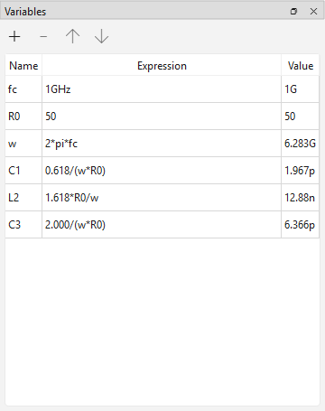

The low-pass example computes all component values from `fc` and `R0`: change `fc` to `2GHz` and the whole filter moves.

### 4.3 Hierarchical sheets

Any schematic of the project can be placed in another one as a block:

1. In the sub-sheet, mark its connections with **sheet ports** (`basic:sheet_port`, Library → Hierarchy) and give each a name, such as `in` and `out`.
2. In the parent schematic, find the sub-sheet in the Library panel under **Sheets**, or right-click it in the Project panel and choose *Place as Sheet*.
3. The block shows one pin per sheet port. Ports on the left half of the sub-sheet appear on the left.

The sub-sheet's variables become parameters of the block: a value set on the block overrides the variable for that instance only. In the receiver example, the IF strip's `gain` variable is set from the top sheet's `if_gain`.

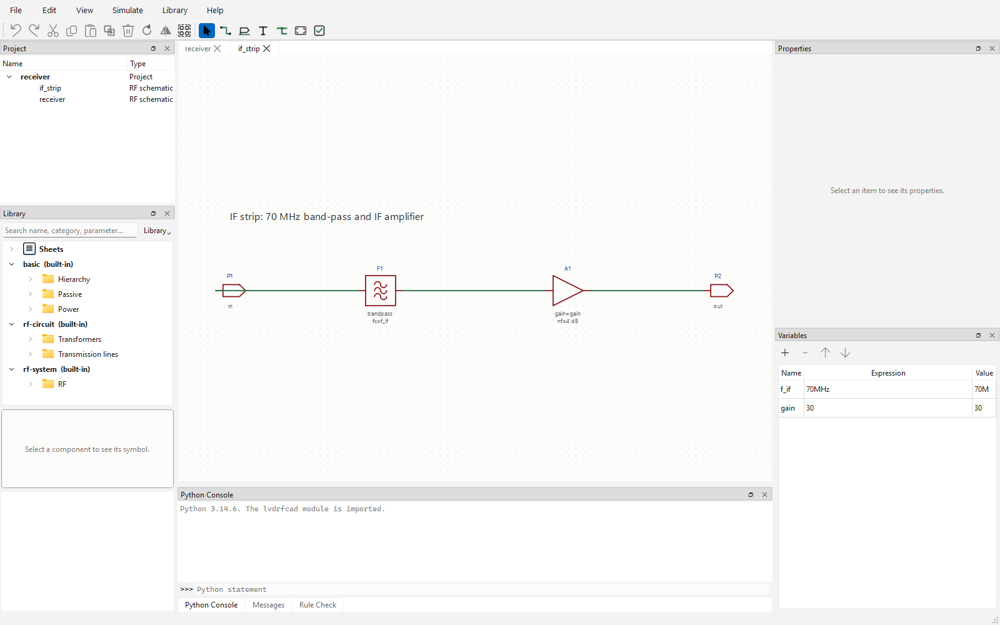

Analyses flatten the hierarchy: a component inside instance X1 is called `X1/A1` in results.

---

## 5. Component libraries

### 5.1 Built-in libraries

| Library | Content |
|---|---|
| `basic` | Resistor, capacitor and inductor (with optional Q), ground, sheet port |
| `rf-system` | Behavioural blocks: amplifier, attenuator, filter (low/high/band-pass, band-stop; ideal, Butterworth, Chebyshev), mixer, signal source, local oscillator, splitter, combiner, directional coupler, SPDT switch, isolator, circulator, cable, antenna, frequency multiplier, phase shifter, ADC, S-parameter blocks (1 to 4 ports), simulation port, termination |
| `rf-circuit` | Ideal transmission line, open and short stubs, coupled lines, microstrip, stripline, coax, coplanar waveguide, ideal transformer |
| `spice-sources` | DC, sine, pulse, PWL, exponential and SFFM voltage and current sources, free SPICE source text, controlled sources (E, F, G, H), behavioural sources |
| `spice-semiconductors` | Generic diode, zener, NPN, PNP, MOSFETs and JFETs with editable model parameters, and common parts: 1N4148, 1N4007, 1N5819, BAT54, BZX84C5V1, red LED, 2N3904, 2N3906, 2N2222A, BC547B, BC557B, TIP31C/32C, 2N7000, BSS138, BSS84, IRF540N, J310, 2N5457 |
| `spice-ics` | Ideal and macromodel op-amps (generic, LM358-, TL072-, OPA2134-like, rail-to-rail), comparators, fixed and adjustable regulators (7805, 7812, LM1117-3.3, LM317-like), TL431-like reference, logic gates and a Schmitt trigger |
| `spice-misc` | Potentiometer, coupled inductors and transformers, crystal, voltage- and current-controlled and timed switches, lossless and lossy transmission lines, voltage, differential and current probes |
| `spice-instruments` | Oscilloscope, voltmeter, ammeter, function generator, spectrum analyser, Bode plotter ([chapter 12](#12-virtual-instruments)) |

The meaning of every parameter is listed in the reference `docs/libraries.md`.

The Library panel shows the parts the current schematic can simulate: an RF schematic sees the `basic`, `rf-…` libraries, a SPICE schematic the `basic` and `spice-…` libraries. R, L, C and ground work in both.

The IC models are behavioural ("…-like"): they reproduce the datasheet's main figures (gain-bandwidth, slew rate, output swing, dropout), not every detail of the real part. For a particular part, import the manufacturer's SPICE model ([14.1](#141-importing-vendor-models)).

RF blocks and circuit elements are referenced to ground: only their signal pins are drawn. A one-pin part such as a termination or a stub connects from its pin to ground.

### 5.2 Library browser

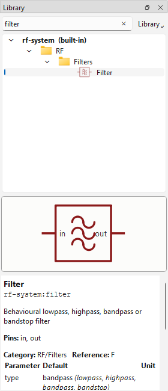

- Type in the search box to filter by name, category, description or parameter name.
- Select a component to see its symbol, pins, parameters and models.
- Double-click to place it; drag it onto the schematic; right-click for more (edit symbol, copy key, new component).

### 5.3 Your own components

*Library → New Component…* or *Edit Symbol…* on a component opens the symbol editor.

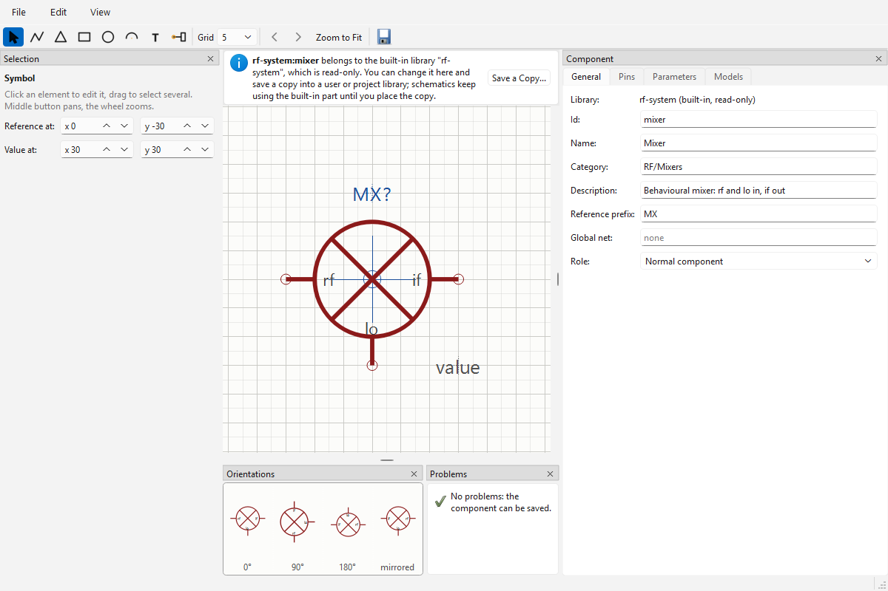

- Draw the symbol with lines, polygons, rectangles, circles, arcs and text; place pins on the 10-unit grid (a pin's line points towards the body).
- Define pins, parameters (with units, defaults and choices) and models in the tabs. A model tells each analysis how to simulate the part, for example an S-parameter file (`sparameters` model, file `{file}`) or a behavioural amplifier.
- The problem list shows what must be fixed before saving.
- Components are saved into a **user** library (shared by all your projects) or a **project** library (in the project's `libraries` folder, travelling with the project). Built-in components are read-only; *Save a Copy…* puts an edited copy into one of your libraries.

*Library → Manage Libraries…* lists all libraries, creates new ones and sets the folder of the user libraries.

Each schematic keeps a copy of the definitions it uses. If a library is missing on another computer, the copy is used and the part is marked; if the library changed since you saved, the part is marked too, so differences never go unnoticed.

---

## 6. S-parameter and noise simulation

### 6.1 Ports

The S-parameter analysis needs **simulation ports** (`rf-system:port`, Library → Ports). Each port has:

- `num`: the port number, 1, 2, 3, … It must be unique. **The number, not the reference name, defines S21, S31 and so on.**
- `z0`: the reference impedance (50 Ω by default). Each port may have its own.

S-parameter `Sij` is the wave leaving port *i* divided by the wave entering port *j*, with all other ports terminated in their own z0. With three ports you get the full 3 × 3 matrix.

Sources, LOs, antennas, ADCs and terminations are **not** ports: in the S-parameter analysis they are loads of impedance z0 (with thermal noise).

### 6.2 Running an analysis

- *Simulate → Run Simulation* (Ctrl+R) runs the current analysis. The first time, a dialog asks for the frequency sweep: start, stop, number of points, linear or logarithmic, or a list of frequencies; and whether to compute noise. Start and stop accept expressions such as `f0/2`.
- Analyses are stored in the schematic. Use the **Analysis** selector above the results to switch, and *New Analysis*, *Edit*, *Delete* to manage them.
- **Auto-run** re-simulates automatically after every change to the schematic.
- Simulations run in the background; the editor stays usable. **Stop** cancels a long run.

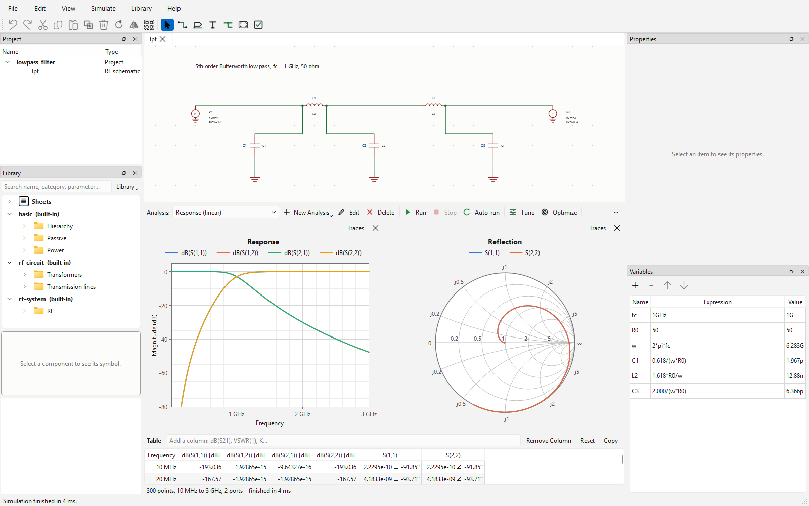

### 6.3 Plots

A new analysis gets default plots: |S| in dB of all parameters, the noise figure (two-ports), and a Smith chart of the reflections. Add plots with *Add Plot* (rectangular, Smith, polar) and open a plot's **Traces** editor to add or remove traces.

A trace is a **measurement expression**:

| Expression | Meaning |
|---|---|
| `S21`, `S(2,1)`, `Z(1,1)`, `Y(2,1)` | network parameters (complex) |
| `dB(S21)`, `mag(S21)`, `phase(S21)`, `uphase(S21)`, `re(Z11)`, `im(Z11)` | 20·log10, magnitude, phase (degrees), unwrapped phase, real and imaginary part |
| `GD(S21)` | group delay in seconds |
| `Zin(1)`, `Yin(1)`, `VSWR(1)`, `RL(1)` | input impedance and admittance at a port (others terminated), VSWR, return loss |
| `NF`, `NF(2,1)` | noise figure in dB (`NF` alone for two-ports) |
| `NFmin`, `Rn`, `GammaOpt` | two-port noise parameters |
| `K`, `mu`, `mup`, `Delta`, `MAG` | stability factors, maximum available or stable gain |
| `dB(S21) - dB(S11)`, `2*NF` | arithmetic |

On plots:

- Drag a rectangle to zoom, wheel to zoom at the cursor (over an axis: that axis only), middle button to pan, double-click to reset.
- Right-click to add a marker, put a marker on the maximum or minimum, set a reference marker (others then show differences) and export.
- Drag markers along their trace. Click a legend entry to hide or show a trace.
- Smith chart markers show Γ, the impedance and VSWR; the admittance grid can be turned on.
- *Export* writes PNG, SVG or CSV, or copies the image.

The **table** under the plots lists the measurements per frequency; add columns by expression, copy them or export CSV. *Export → Touchstone* saves the S-parameters (and noise parameters of two-ports) as a `.sNp` file, and *Simulate → Open Result in S-Parameter Editor* opens them in the S-parameter editor.

### 6.4 What is simulated

The analysis is linear and small-signal: amplifiers are ideal gain blocks with their noise figure, filters follow their prototype response, transmission lines include their losses, S-parameter blocks use their file (interpolated, with noise data when present). Noise uses the noise-wave method: passive parts produce thermal noise at 290 K.

**Mixers and multipliers change frequency, which a linear S-parameter analysis cannot represent.** Across a mixer, the analysis only shows the leakage between its ports, and warns about it. For conversion gain and noise through mixers, use the [system budget](#10-system-budget-frequency-plan-and-spurs).

---

## 7. Tuning and optimisation

### 7.1 Tuning

*Simulate → Tune…* (or **Tune** above the results) opens the tuning panel next to the plots.

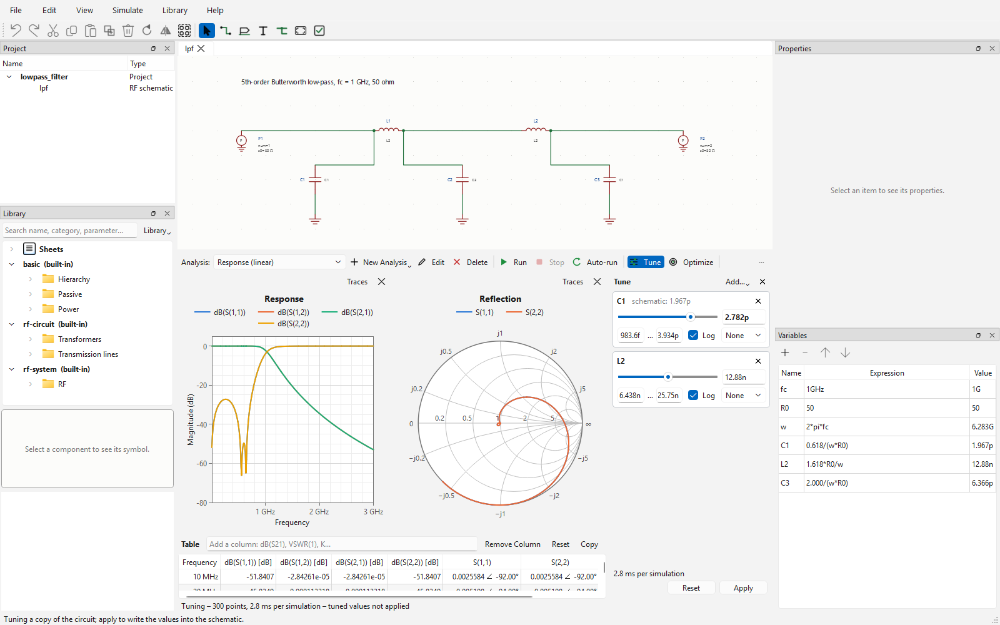

1. *Add…* a variable or a component parameter.
2. Move its slider or type a value: the plots update immediately (many times per second on small circuits). The range (min, max), logarithmic stepping and a standard series (E12 … E96) are set per row.
3. **Apply** writes the tuned values into the schematic as one undo step. **Reset** returns to the schematic's values.

Tuning works on a copy of the design: the schematic does not change until you apply, and you can keep editing it while tuning.

### 7.2 Optimisation

*Simulate → Optimize…* opens the optimisation dialog.

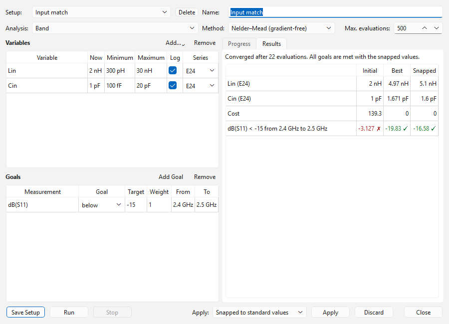

1. Choose the analysis whose sweep is used.
2. Add **variables** with their ranges, and optionally a standard series to round the final values to.
3. Add **goals**: a measurement, a condition (below, above, equal, minimise, maximise), a target, a frequency band and a weight. For example `dB(S11)` below `-15` from 2.4 GHz to 2.5 GHz.
4. Choose the method: **Nelder–Mead** (robust, any goal) or **Levenberg–Marquardt** (faster for target goals).
5. **Run**. The progress tab shows the best cost and the goal status as the optimiser works.
6. The results tab compares the initial, best and rounded values and the goals. **Apply** writes the values you choose into the schematic (one undo step), or **Discard** them.

Optimisation setups are stored in the schematic and can be run again later.

If a goal is not met, check that it is achievable: an optimiser cannot make a filter flatter than its order allows. Wider variable ranges, more variables or Nelder–Mead may help.

---

## 8. Matching network synthesis

*Simulate → Matching Network Synthesis…* designs networks that match a load impedance to a source.

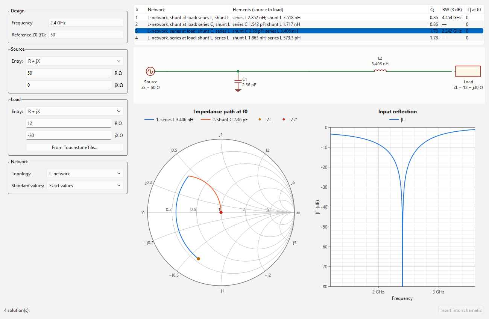

1. Enter the frequency, the source impedance and the load impedance, as R + jX or as a reflection coefficient. *From Touchstone file…* reads the load from a one-port or two-port file at that frequency. When a simulation result exists, the window starts with the impedance seen at port 1.
2. Choose a topology: L-network, Pi or T (with a loaded Q), multi-section ladder, quarter-wave transformer, single stub, double stub.
3. Optionally round the values to a standard series; the remaining mismatch is shown.
4. Select a solution in the list to see the network, its impedance path on the Smith chart and its reflection versus frequency.
5. **Insert into schematic** places the network in the current schematic, wired, with net labels `MATCH_IN` and `MATCH_OUT` at its ends. Connect or rename them; undo removes the whole network.

---

## 9. S-parameter files

*File → Open Touchstone File…* (Ctrl+Shift+O) opens `.s1p` to `.s4p` and Touchstone 2 files in the S-parameter editor.

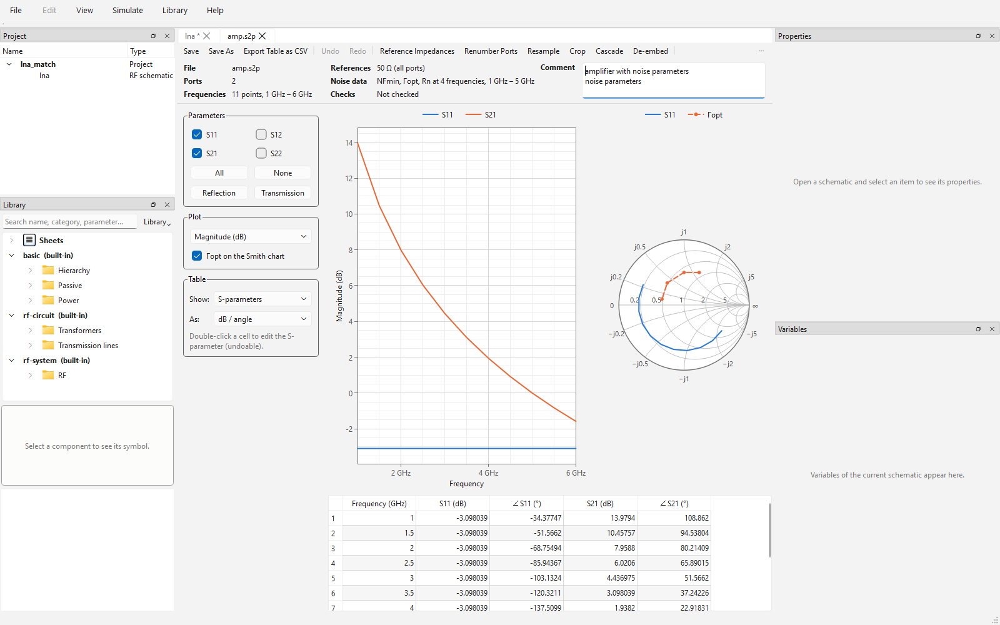

- The header shows ports, frequency range, reference impedances, noise data and the file comment.
- Choose which parameters to plot and how (dB, magnitude, phase, group delay, VSWR, stability, noise).
- The table shows the data as S, Z, Y, ABCD or T, in RI, MA or dB form. S values can be edited.
- Operations: change reference impedances, renumber ports, resample, crop, cascade with another two-port, de-embed fixtures, and check passivity and reciprocity (failing frequencies are highlighted). Every operation can be undone.
- *Save As* writes version 1 or 2, in RI, MA or DB format.

To use a file in a circuit, place an S-parameter block (`rf-system:nport1` … `nport4`, Library → S-parameters) and set its `file` parameter. Put the file in the project folder so that the project stays self-contained. Pin `pK` is port K of the file.

---

## 10. System budget, frequency plan and spurs

The budget analysis follows a signal through a chain of blocks and reports, per stage and cumulatively, gain, noise figure, intercept and compression points, signal and noise levels, SNR, dynamic range and headroom. It handles frequency conversion and includes a mixer spur analysis.

### 10.1 Setting up a budget

*New Analysis → RF Budget Analysis…*

- **Start**: the chain starts at a source, at port 1 or at an antenna (automatic), or at the component you choose.
- **Path**: normally traced automatically to the load (termination, ADC, port or antenna). At a splitter, coupler, switch or circulator the automatic path takes the first output and warns; to choose, use *Trace* and pick the exit pin of that component (written `SPL1.out2`).
- **Frequency** and **power** of the input signal: taken from the source block, or typed here. **A port or an antenna has no frequency or power: enter them here.**
- **Bandwidth**: the noise bandwidth for noise power, SNR and dynamic range.
- **Mismatch**: *actual S-parameters* includes reflections between stages; *ideal* cascades matched stages.
- **Swept budget** (optional): repeats the budget over a range of input frequencies.
- **Spur analysis** and its maximum order.

### 10.2 Results

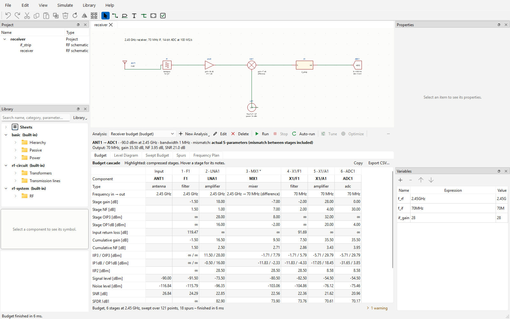

**Budget** tab: one column per stage. Stage gain, NF, OIP3 and OP1dB; cumulative gain, NF, IIP3/OIP3, IP1dB/OP1dB, IIP2; signal and noise level, SNR, SFDR and compression headroom. Stages driven into compression are highlighted. A chain that ends in an ADC adds its full-scale headroom, quantisation SNR and the frequency the signal aliases to.

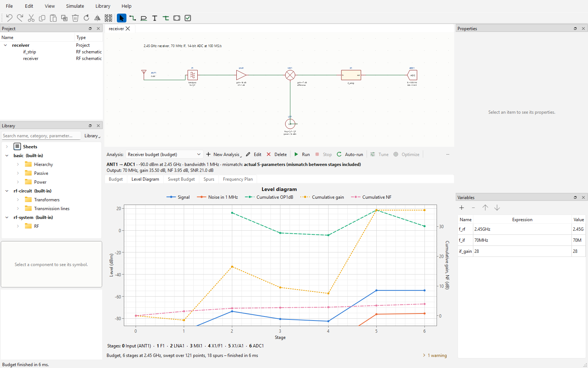

**Level Diagram**: signal, noise and compression levels along the chain.

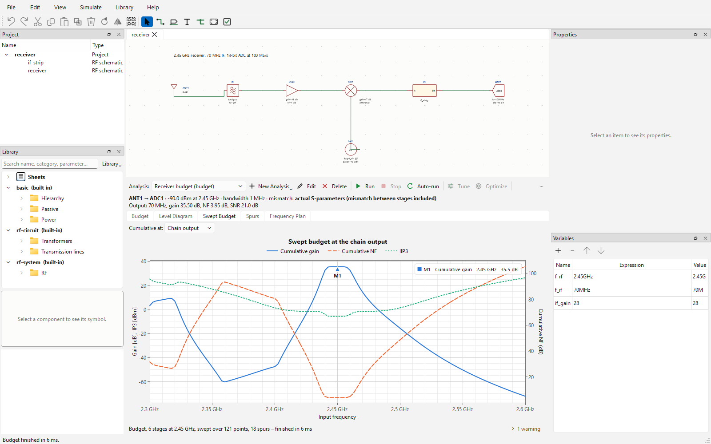

**Swept Budget**: cumulative gain, NF and IIP3 versus input frequency, at the output or at a chosen stage. For a chain with mixers this is the conversion gain.

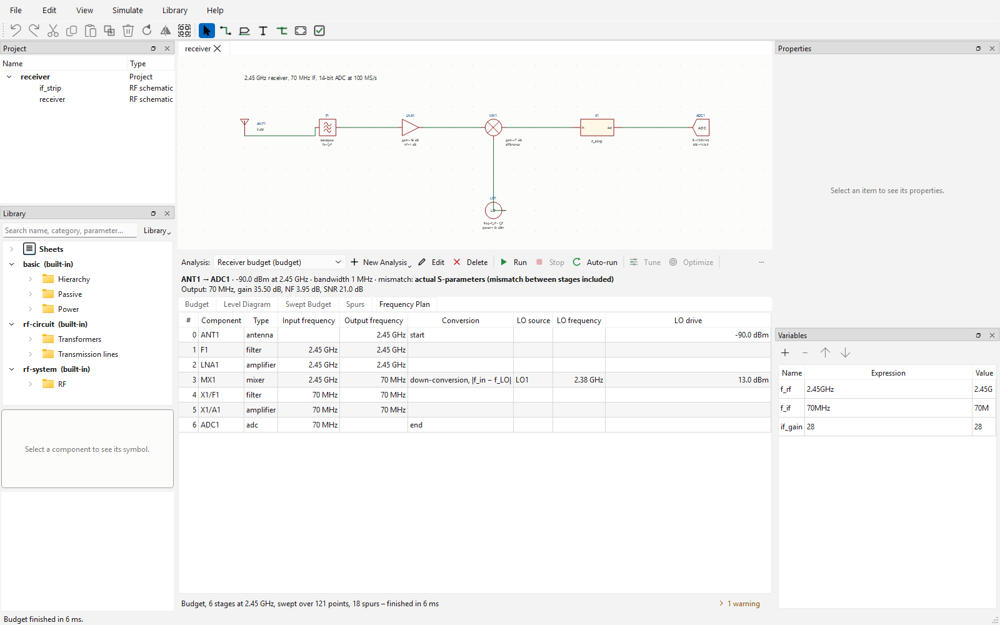

**Frequency Plan**: the frequency at every stage, and for each mixer its LO source, LO frequency and LO drive level. The LO is found by following the mixer's `lo` pin back to an LO block, through amplifiers, filters and multipliers.

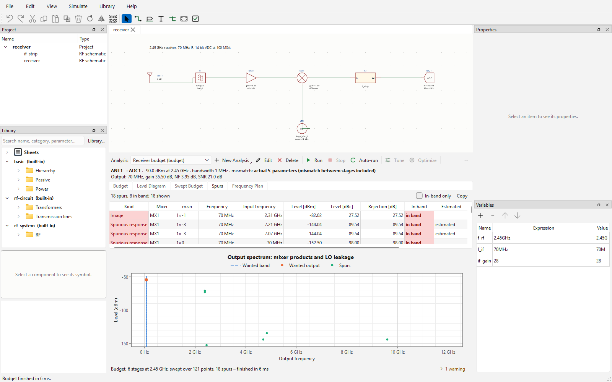

**Spurs**: for every mixer, the m × n products at the output, the spurious responses (input frequencies that land in the output band, including the image and half-IF), and LO leakage to the output and back to the input. In-band entries are highlighted. Levels come from the mixer's spur table if it has one (`spur_table` parameter; format in `docs/libraries.md`), otherwise from an estimate marked as such.

### 10.3 Mixers: which product do you get?

A mixer produces f_in + f_LO and |f_in − f_LO|. Its **`product`** parameter, shown on the symbol, selects the one the budget follows:

| `product` | Wanted output |
|---|---|
| `sum` | f_in + f_LO, for example an up-converter from 1 GHz with a 15 GHz LO to 16 GHz |
| `difference` | \|f_in − f_LO\|, for example a down-converter from 2.45 GHz with a 2.38 GHz LO to 70 MHz |
| `auto` (default) | By wiring: the difference when the signal enters at `rf`; when it enters at `if`, the sum for `side` = low and the difference for `side` = high |

The signal may enter at either `rf` or `if`; with `sum` or `difference` the wiring direction does not matter. The budget table shows the product used next to the mixer's frequencies, for example "1 GHz → 16 GHz (sum)".

If the stages after a mixer pass the other product far better than the selected one (for example a 16 GHz filter after a mixer that produces 14 GHz), the budget warns and suggests changing `product`.

### 10.4 Notes

- Compression and intercept figures are those of the blocks' parameters; the analysis does not simulate nonlinear behaviour.
- Mixer P1dB is estimated as IIP3 − 10 dB.
- Shunt parts placed between blocks on the signal path (a stub, a capacitor to ground) are ignored by the budget, with a warning.

---

## 11. SPICE simulation

SPICE schematics are simulated with **ngspice 47**, which is part of the installation. Use them for anything with transistors, diodes, op-amps, regulators, switches or logic: bias points, transients, distortion, noise and loop responses.

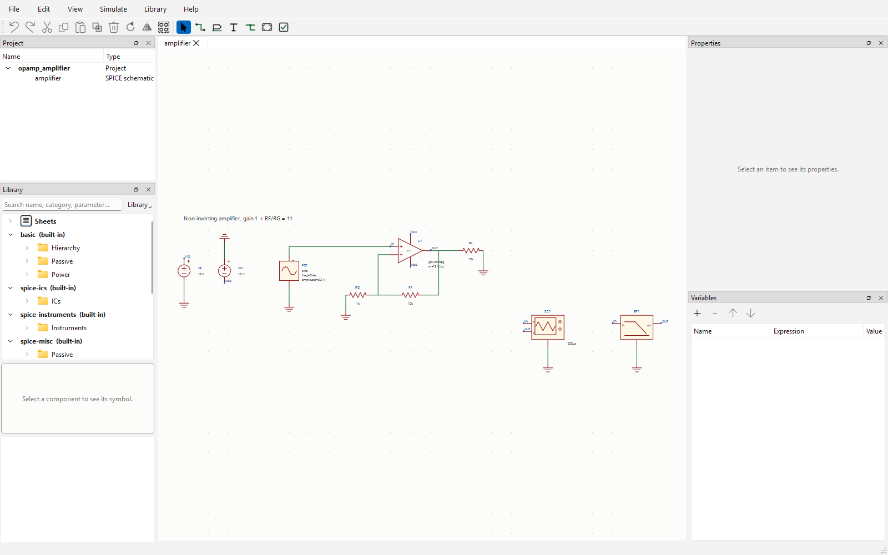

### 11.1 Drawing a SPICE schematic

*File → New Document → New SPICE schematic…* creates a `.lvdspice` document. Drawing works as in [chapter 3](#3-drawing-schematics); the Library panel now offers the `spice-…` libraries.

- Every circuit needs **ground** (`basic:ground`), and every node needs a DC path to it. A capacitor alone on a node, or an open winding, makes the matrix singular.
- Net labels name nodes. Name the nodes you want to look at (`in`, `out`, `vcc`): you then write `v(out)` in plots and setups instead of a generated name.
- Supplies are ordinary sources (`spice-sources:vdc`). Connect them with labels such as `vcc` and `vee` to keep the drawing clear.
- Values are evaluated as in the rest of the program (`1k`, `4n7`, `2.2uF`, `1MHz`, M = mega, m = milli) and written to SPICE as plain numbers, so the SPICE meaning of `M` (milli) never bites. Text parameters, such as a PWL list or a behavioural expression, go to SPICE as written: there use `meg` for mega.

### 11.2 Analyses

The results area of a SPICE schematic has its own toolbar: the analysis list, **New…**, **Edit…**, **Delete**, **Run** (F5), **Pause**, **Stop** (Shift+F5), **Sweeps & Statistics**, **Show on Schematic** and **Export Netlist…**. *Simulate → Run Simulation* (Ctrl+R) and *New Analysis…* work too.

| Analysis | What it computes | Main fields |
|---|---|---|
| Operating point | DC node voltages, branch currents and device powers | – |
| DC sweep | The circuit while a source (or the temperature) is swept; nested sweeps draw a family of curves | source, start, stop, step; optional second source |
| AC | Small-signal frequency response around the operating point; sources need an AC magnitude | dec/oct/lin, points, start, stop |
| Transient | Waveforms in time | stop time, print step, optional start and maximum step, initial conditions |
| Noise | Output noise density and input-referred noise; integrated totals | output net, input source, frequency sweep |
| Fourier | A transient whose signals are split into harmonics, with THD (like `.four`) | transient fields, fundamental, harmonics, signals |
| Transfer function | DC gain, input and output resistance | output (net, `v(a,b)` or `i(V1)`), input source |
| Pole-zero | Poles and zeros of a transfer function | input and output nets, voltage or current transfer |
| Sensitivity | Sensitivity of an output to every parameter, DC or over frequency | output |

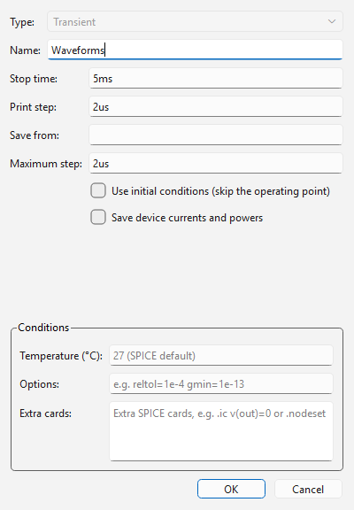

Fields are expressions of the schematic variables. Every analysis also has **Conditions**: the temperature (°C), simulator options (`reltol=1e-4`, `gmin=1e-13`, …) and extra SPICE cards (`.ic v(out)=0`, `.nodeset`).

The simulation runs in the background: you can keep editing, follow the progress below the results, **Pause** and resume a long transient, or **Stop** it. Problems in the circuit (an unknown part, a parameter without a value) are listed before anything runs; the simulator's own messages are in the **Log** tab.

### 11.3 Waveforms

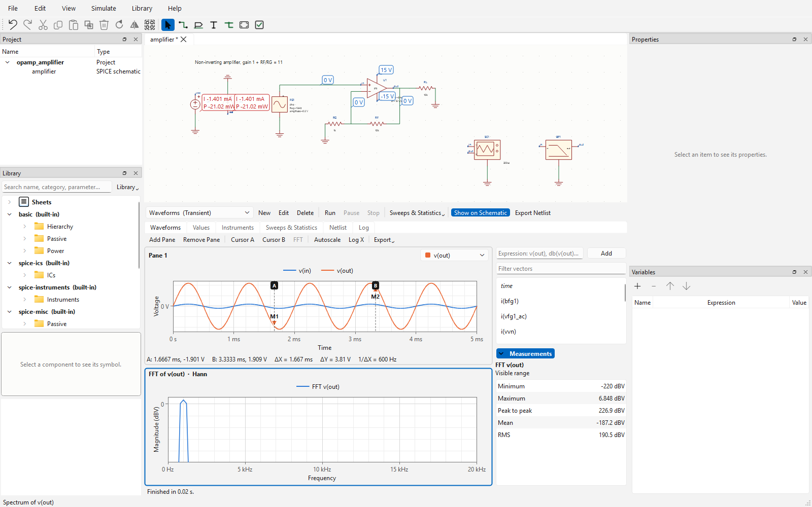

DC sweep, AC, transient and noise results open in the **Waveforms** tab. Probes placed on the schematic (`spice-misc:vprobe`, `vdiffprobe`, `iprobe`) give the first traces; without probes the labelled nodes are shown.

- **Traces** are expressions, typed in the box at the top right or picked from the vector list (double-click adds): `v(out)`, `v(out,in)` (a difference), `i(V1)` (the current of a source, by its reference), `db(v(out)/v(in))`, `ph(v(out))`, `i(RL)*1000`, `deriv(v(c))`. Functions: `db`, `db10`, `mag`, `ph`, `cph` (unwrapped phase), `real`, `imag`, `gd` (group delay), `deriv`, `integ`, `mean`, `rms`, `max`, `min`, `pkpk`, `sqrt`, `exp`, `ln`, `log10` and the usual trigonometry.
- **Panes**: *Add Pane* stacks another plot; all panes share the x zoom. A second unit (for example A next to V) goes to the right axis. AC traces are shown in dB; right-click a trace for magnitude, phase, real or imaginary part.
- **Cursors** A and B show their values, ΔX, ΔY and 1/ΔX.
- **Measurements** (bottom right) are taken on the trace selected in the pane header, over the visible range or between the cursors: minimum, maximum, peak-to-peak, mean, RMS, frequency, period, duty cycle, rise and fall time (10–90 %), overshoot and THD. *Fourier…* lists the harmonics.
- **FFT** makes a pane with the amplitude spectrum of the selected trace (window selectable: Hann, Hamming, Blackman, Blackman-Harris, flat top, rectangular; dBV or V).

The panes of each analysis are saved with the schematic.

### 11.4 Values and the annotated schematic

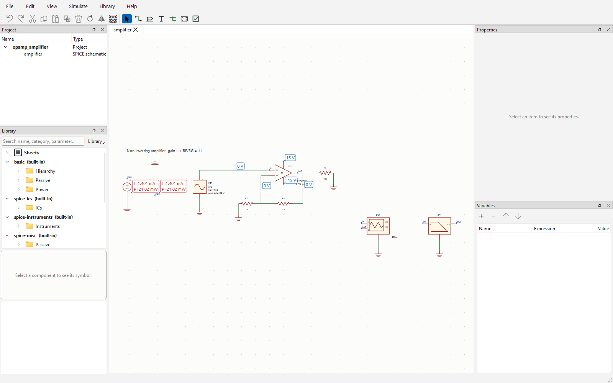

Results that are numbers rather than waveforms are listed in the **Values** tab: the operating point (every node voltage with its net name, source currents, device currents and powers), transfer function, poles and zeros (with their frequency), sensitivities, noise totals and Fourier harmonics.

After an operating point the values are also drawn on the schematic: node voltages in blue on the wires, currents and powers next to the parts. **Show on Schematic** turns them off; they disappear as soon as the circuit is edited.

### 11.5 Netlist

The **Netlist** tab shows what is given to ngspice: one line per part, generated from each component's SPICE template, followed by the analysis cards. *Export Netlist…* saves it as a `.cir` file, for example to run it in another simulator. Parts in sub-sheets are flattened; their names are prefixed with the sheet instance (`X1_R1`).

---

## 12. Virtual instruments

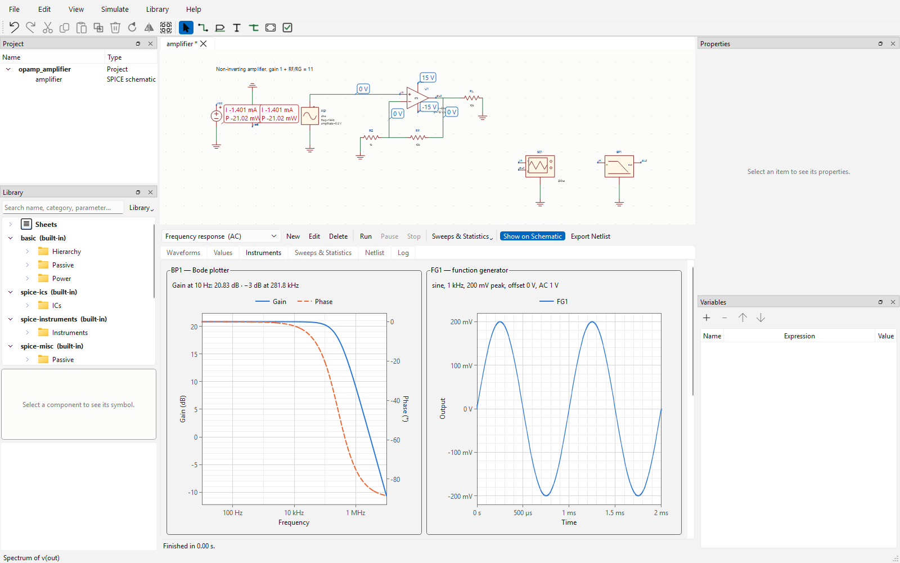

Instruments are parts from the `spice-instruments` library. Wire them to the circuit like a probe; they show the latest results in the **Instruments** tab. Except for the ammeter and the function generator, they add nothing to the circuit.

| Instrument | Shows | Settings |
|---|---|---|
| Oscilloscope | Channels 1 and 2 against the `ref` pin, from the latest transient. Like a real scope it shows the latest triggered sweep of ten divisions, with peak-to-peak and frequency per channel. | time/div, volts/div and centre voltage per channel, trigger channel and level |
| Voltmeter | DC value of the operating point; DC, RMS and AC RMS of the transient's second half (after start-up) | – |
| Ammeter | The same for the current entering `p`. It is a 0 V source in series: it does change the netlist, not the circuit. | – |
| Function generator | Sine, square, triangle or sawtooth with an offset and phase, plus an AC magnitude for AC analyses; its output over two periods | waveform, frequency, amplitude, offset, phase, AC |
| Spectrum analyser | FFT of the input against `ref` from the latest transient, in dBV, with the peak | highest frequency, window |
| Bode plotter | Gain (dB) and phase of `out/in` from the latest AC analysis, with the −3 dB frequency. Without an AC analysis it offers to create one. | – |

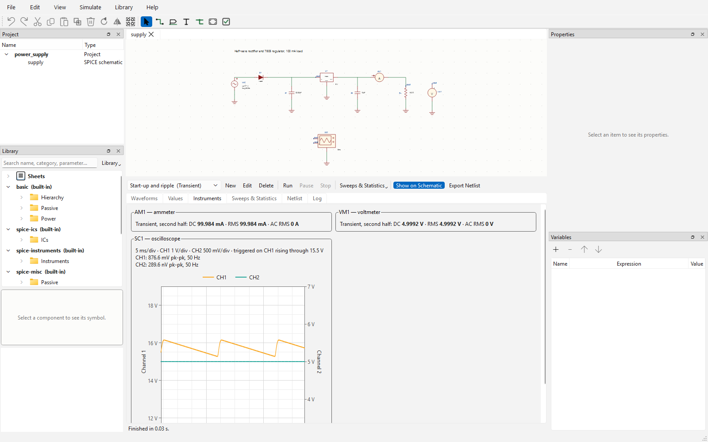

---

## 13. Sweeps, Monte Carlo, worst case and optimisation

**Sweeps & Statistics** in the results toolbar runs the current analysis many times. Each run uses a copy of the project, so the schematic itself never changes (except when you apply optimised values). The setup is stored with the analysis.

**Measures** reduce every run to numbers: a trace expression and a function — `value` (at an x position, or the first point for an operating point), `max`, `min`, `mean`, `rms`, `pkpk`, `risetime`, `falltime`, `frequency`, `period`, `duty`, `overshoot`, `settling`, `crossing` (first time a level is crossed) or `thd` — optionally within a window.

Values that change are written as **targets**: a schematic variable (`fc`), a component parameter (`R1.r`, `U1.gbw`), or `temperature`.

| Batch | What it does |
|---|---|
| Parameter sweep | Up to three targets, each a linear or logarithmic range or a list; nested sweeps run every combination. The plot shows a measure against the swept value, one curve per outer value. |
| Monte Carlo | Each run draws every toleranced value: Gaussian (the tolerance is 3 σ) or uniform. `R*.r` applies to every resistor reference starting with R. Run 0 is the nominal circuit. Statistics: nominal, mean, σ, minimum, maximum; the plot is a histogram. |
| Worst case | Finds how each measure depends on each toleranced value, then simulates for every measure the two corners that push it lowest and highest. Few runs, the true extremes for monotonic circuits. |
| Optimise | Changes targets within their ranges (logarithmic for positive ranges) until goals on measures are met (below, above, equal, minimise, maximise). Values can be rounded to an E-series at the end; **Apply to Schematic** writes them as one undo step. |

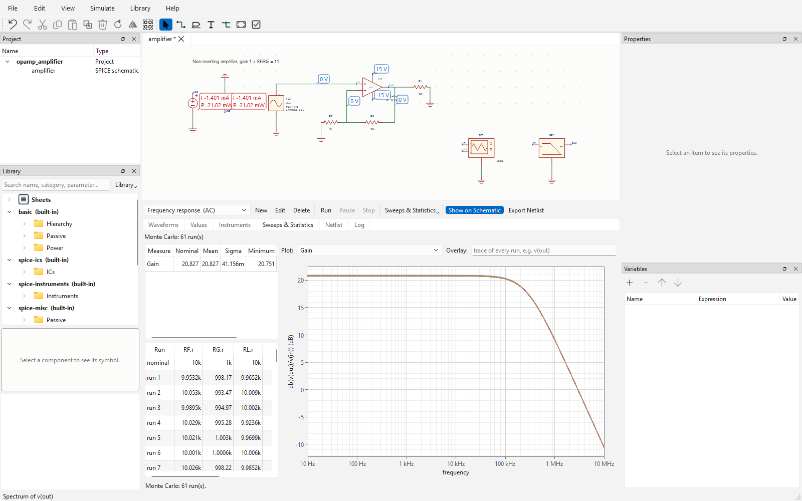

The **Sweeps & Statistics** tab lists every run with its values and measures. Type an expression into **Overlay** to draw it for all runs at once (for example `db(v(out)/v(in))` for the spread of a frequency response); double-click a run to show its waveforms.

ngspice can run one simulation per process, so batches start one worker process per processor core (`lvdrfcad-cli --spice-run`). Runs of long transients then take about the time of one run per core; for very short simulations the start of each worker process takes longer than the simulation itself.

---

## 14. SPICE models and netlists

### 14.1 Importing vendor models

*Library → Import SPICE Models…* reads a model file from a manufacturer (`.lib`, `.mod`, `.cir`, `.sub`), lists its `.model` and `.subckt` entries and adds the ticked ones as components to a project or user library.

- Diodes, bipolar transistors, MOSFETs (including VDMOS) and JFETs get the symbol of the matching generic part.
- Subcircuits (op-amps, regulators, anything else) get a box with one pin per subcircuit node: inputs on the left, the rest on the right. Edit the symbol afterwards if you like ([5.3](#53-your-own-components)); keep the pin names.
- Subcircuit parameters (`params:`) become component parameters.
- With a project open, the model file is copied into the project's `models` folder, so the project stays complete when you pass it on.
- Files with `.lib` sections are read through the section of each entry. Encrypted models cannot be simulated and are refused.

### 14.2 How a part becomes SPICE

Each SPICE component has a model with a **template**, for example `R{ref} {pin:p} {pin:n} {r}`: `{ref}` becomes the part's name, `{pin:…}` the node of a pin, and `{r}` the evaluated value of parameter `r`. Shared subcircuit text and `.include` files are added once. Write your own parts this way in the symbol editor; the contract is described in `docs/libraries.md`.

A part can also be defined by **Python**: its model holds a function `spice(ref, nodes, params)` that returns netlist lines. Use it for parts computed from their parameters, such as a ladder network of n sections or a filter whose element values follow a formula. See `docs/python-api.md`.

### 14.3 Importing a netlist

*File → Import SPICE Netlist…* turns an existing SPICE netlist into a SPICE document of the project. The document has no drawing: it simulates the netlist text. Its analysis cards (`.op`, `.ac`, `.dc`, `.tran`, `.noise`, `.tf`, `.pz`, `.sens`, `.four`) become analyses; `.control` blocks and `.print`/`.plot` cards are left out. Relative `.include` and `.lib` paths are made absolute. Everything in chapters 11–13 then works on it, with node and element names as written in the netlist.

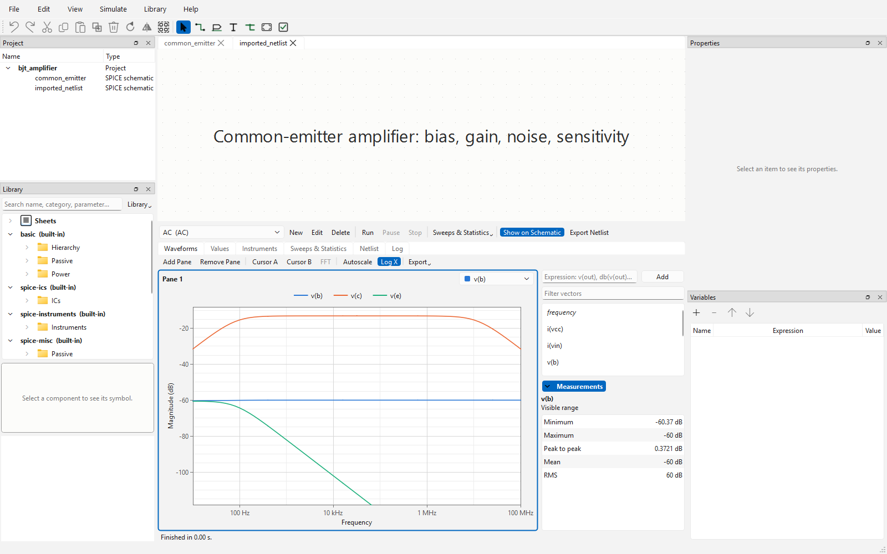

---

## 15. Antenna elements

The antenna designer works with two kinds of document. An **antenna element** describes one radiator: an analytic model or a measured pattern. An **antenna array** ([chapter 16](#16-antenna-arrays)) places many elements and feeds them. Several arrays can use the same element document.

Every antenna view uses the same conventions. θ is measured from +z; φ is measured from +x towards +y. An element radiates towards +z, and its reference polarisation is x. A planar array lies in the xy-plane.

### 15.1 Element documents

*File → New Document → New Antenna element…* creates an element document; double-click it to open it.

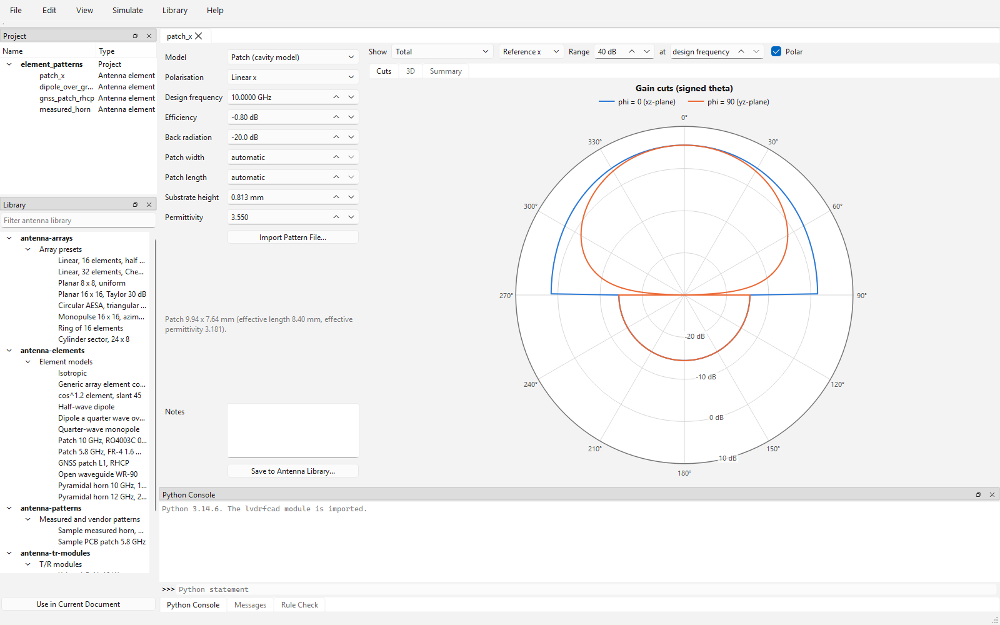

The left panel holds the model and its parameters. The right side has three views:

- **Cuts**: the φ = 0 and φ = 90° planes, in polar or rectangular form.
- **3D**: the whole pattern.
- **Summary**: peak directivity, gain, peak direction, beamwidths and front-to-back ratio.

The bar above the views chooses the component to show (total, co-polar, cross-polar, RHCP, LHCP, E_θ, E_φ), the dynamic range, and the frequency at which the pattern is drawn.

| Model | Parameters | Typical directivity |
|---|---|---|
| Isotropic | none | 0 dBi |
| cos^n | exponent n, back radiation | 10 log 2(n+1), 5.4 dBi for n = 1.5 |
| Dipole | length (0: half wave) | 2.15 dBi (half wave), 1.76 dBi (short) |
| Dipole over ground | length, height over an infinite ground plane (0: λ/4) | about 7.5 dBi |
| Monopole over ground | height (0: λ/4) | 5.16 dBi at the horizon |
| Patch (cavity model) | width, length (0: designed for the frequency), substrate height and permittivity, back radiation | 6 to 8 dBi |
| Aperture / horn | aperture a (y, broad wall) and b (x), cosine (TE10) or uniform distribution | from the aperture size |
| Imported pattern | a pattern file | as measured |

- **Polarisation**: linear x or y, slant ±45°, RHCP or LHCP. A circular element is two orthogonal copies fed in quadrature.
- **Efficiency**: the radiation efficiency in dB. Gain equals directivity plus efficiency.
- **Patch**: with width and length set to *automatic*, the patch is designed for the design frequency with the textbook equations; the panel shows the resulting size.
- **Aperture**: the model leaves out the phase error of a flared horn, so long horns are optimistic.

### 15.2 Imported patterns

**Import Pattern File…** reads a far-field file and keeps a copy in the project's `patterns` folder, in the application's own CSV format. The element then uses that copy. Accepted files:

- A table with a header naming the columns: `theta`, `phi`, optionally `frequency`, and either a total gain or directivity (dBi or linear), magnitude and phase of E_θ and E_φ, or their real and imaginary parts.
- CST "ASCII farfield" exports (`Theta`, `Phi`, `Abs(Dir.)`, `Abs(Theta)`, `Phase(Theta)`, …).
- FEKO `.ffe` files, one block per frequency.

A file with several frequencies is interpolated in frequency. Negative θ (two-sided cuts) is folded to (|θ|, φ + 180°). A file with gain only, without phase, is taken as x-polarised. The pattern is normalised to directivity, so set the efficiency separately. Grid points missing from the file are set to zero and listed in the Summary.


### 15.3 The antenna library

While an antenna document is open, the **Library** dock shows the antenna library instead of the component library.

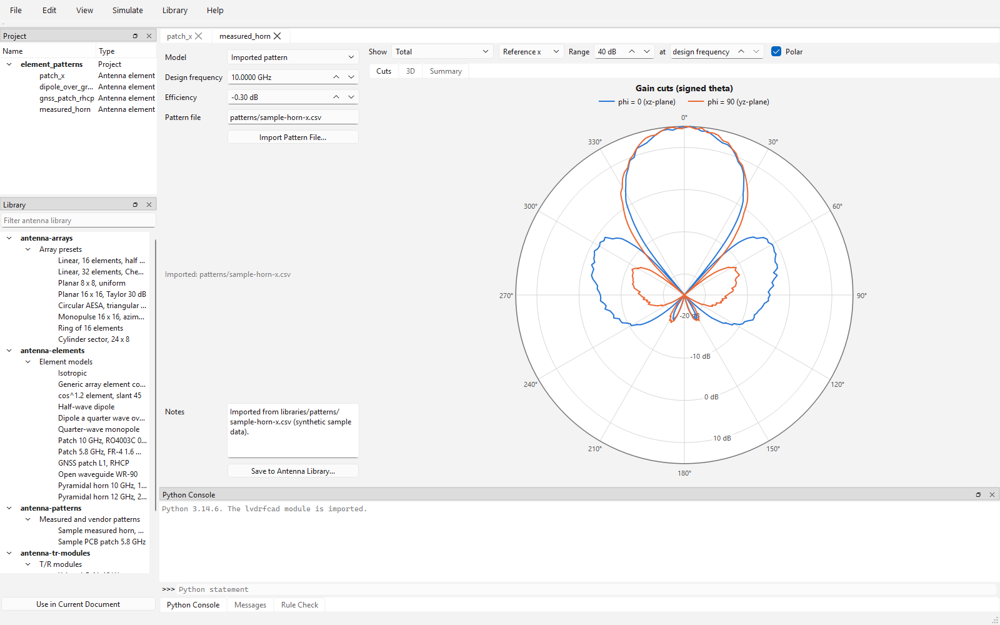

| Library | Content |
|---|---|
| antenna-elements | Analytic models: isotropic, cos^n, dipoles, monopole, patches (10 GHz RO4003C, 5.8 GHz FR-4, GNSS RHCP), open waveguide and two horns |
| antenna-patterns | Elements from pattern files. The two samples are synthetic data that look like measurements; add your own measured or vendor patterns here. |
| antenna-tr-modules | Generic T/R module presets: power, gain, noise figure, phase and attenuator bits, typical errors |
| antenna-arrays | Array presets: lines, planar arrays with tapers, a circular radar AESA, monopulse, a ring and a cylinder sector |

Double-click an entry, or select it and press **Use in Current Document**:

| Entry kind | In an element document | In an array |
|---|---|---|
| Element or pattern | The model is copied into the element. | The array uses the library element. |
| T/R module | not used | Sets the T/R values and the AESA quantisation and errors. |
| Array preset | not used | Replaces the geometry and excitation. |

**Save to Antenna Library…** in an element document stores the element in a library of your user folder (`my-antennas` by default). A pattern file goes with it into the library's `patterns` folder. Antenna libraries are `.lvdantlib` files in the same folders as the component libraries.

---

## 16. Antenna arrays

*File → New Document → New Antenna array…* creates an array document. The new array is an 8 × 8 planar array of cos^1.5 elements at half-wavelength spacing.

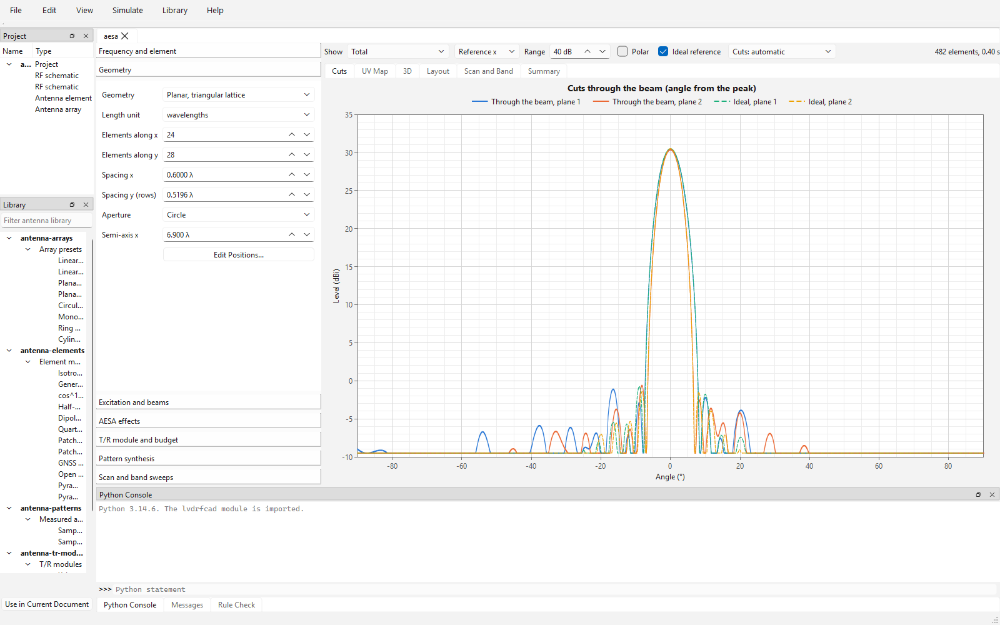

The settings panel on the left has seven pages. Each edit is applied at once, and the results are recomputed in the background; the bar at the top shows the number of elements and the computing time. *Edit → Undo* (Ctrl+Z) reverts edits. Changes made from Python appear immediately.

### 16.1 Frequency and element

- **Operating frequency**: the frequency of all results.
- **Design frequency**: spacings given in wavelengths use it, and phase shifters are set for it. With the two frequencies different, a phase-steered beam squints ([17.5](#175-beam-squint-and-true-time-delay)).
- **Element**: the inline model on this page (isotropic, cos^n, dipoles and so on), an element document of the project, or a library entry.

### 16.2 Geometry

| Geometry | Settings |
|---|---|
| Linear | Elements and spacing along x |
| Planar, rectangular lattice | Elements and spacing along x and y |
| Planar, triangular lattice | As rectangular. Odd rows are shifted by half a spacing, and *Spacing y* is the row spacing: 0.866 × spacing x gives an equilateral lattice. |
| Circular rings | Rings written `radius:count[:rotation]`, separated by commas; optionally an element at the centre |
| Conformal cylinder | Radius, columns over an arc, rows along the axis. Elements face outward and the broadside is +x, so steer to θ = 90°. |
| Custom table | Any list of elements, edited with **Edit Positions…** (below). Each element has a position, an optional boresight normal and rotation (for conformal arrays of any shape), an amplitude and phase for the custom taper, and an on/off switch. |

Lengths are in wavelengths at the design frequency, or in metres. A planar lattice can be cut to a circular or elliptical aperture; with zero semi-axes the largest circle or ellipse that fits the lattice is used.

**Edit Positions…** opens the element editor for any geometry. A lattice, ring or cylinder is first converted to an element table, with the same positions and orientations; with *OK* the array becomes a custom table, and its taper and steering settings still apply. *Edit → Undo* reverts the whole edit in one step.

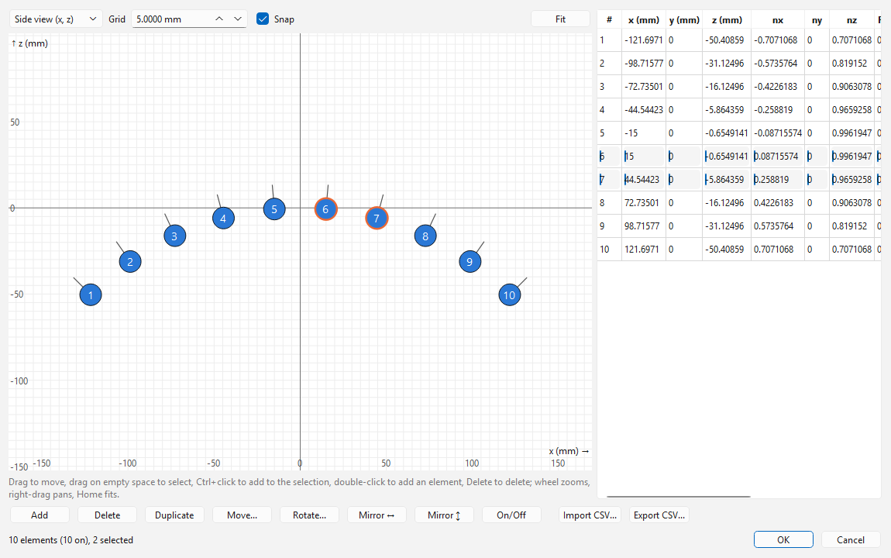

| In the editor | Action |
|---|---|
| Canvas | Drag elements to move them (the grabbed one snaps to the grid), drag on empty space to select, Ctrl+click to add to the selection, double-click empty space to add an element, Delete to delete; wheel zooms, right-drag pans, Home fits |
| View | Top view (x, y) or side views (x, z), (y, z): side views move elements in depth and show conformal arrays; the short lines show each element's boresight |
| Table | One row per element: x, y, z (wavelengths, or millimetres for metre geometries), normal, rotation, amplitude, phase, on. Selecting rows selects the elements on the canvas. |
| Buttons | Add, Delete, Duplicate (one grid step to the right), Move by an offset, Rotate about the view axis, Mirror horizontally or vertically about the selection centre, On/Off, Import and Export CSV (`x, y, z, nx, ny, nz, rotation, amplitude, phase, on`) |
| Ctrl+Z, Ctrl+Y | Undo and redo inside the editor |

From Python, `array.to_custom()` converts the geometry, after which `design['geometry']['elements']` can be changed element by element.

### 16.3 Excitation

**Tapers** set the element amplitudes. Planar arrays take one taper along x and one along y (separable), or *One taper over the radius* for circular apertures.

| Taper | Setting | Notes |
|---|---|---|
| Uniform | none | Highest gain; −13.3 dB side lobes on a line |
| Taylor | side-lobe level, n-bar | The usual radar taper. Over the radius it is the circular Taylor distribution. |
| Chebyshev (Dolph) | side-lobe level | All side lobes equal. Exact for equally spaced positions. |
| Cosine^n | exponent | |
| Cosine squared on a pedestal | edge level | |
| Hamming | none | |
| Custom | per element | The **Custom weights** table on the page: amplitude (dB) and phase (degrees) per element. Pattern synthesis fills it; the amplitude and phase columns of a custom element table are the starting values. −100 dB switches an element off. |

The other excitation settings:

- **Steering** points the main beam to θ, φ:
  - *Phase shifters*: phase per element, set at the design frequency.
  - *True time delay per element*.
  - *Time delay per sub-array, phase per element*.
  - *None (feed phases only)*: no steering phases at all. The direction comes from the custom weights and the orientation of the elements: amplitude steering, switched beams, direction-finding arrays.
- **Sub-arrays** group lattice elements into blocks of *Sub-array x* × *Sub-array y*. They take time delay per sub-array, and optionally one amplitude per sub-array.
- **Extra beams**, **nulls** and the difference patterns are in [chapter 17](#17-beamforming-aesa-effects-and-synthesis).

### 16.4 Views

| View | Shows |
|---|---|
| **Cuts** | The selector in the bar chooses the cuts. *Automatic*: without steering, the principal planes φ = 0 and φ = 90° against signed θ; with steering, or on a cylinder, two great-circle cuts through the beam peak against the angle from the peak. *Horizon (θ = 90)*: the azimuth pattern, drawn as a top view in polar form (φ = 0 to the right, counter-clockwise), for direction-finding and other horizon arrays. Dashed traces are the ideal array, without AESA effects. |
| **UV Map** | Gain over u = sin θ cos φ and v = sin θ sin φ, with the visible region (unit circle), the beam, and the grating-lobe circles of periodic lattices ([17.4](#174-grating-lobes)) |
| **3D** | The pattern and the element positions; failed elements are red |
| **Layout** | Element amplitude or phase (the selector in the bar). Failed elements are crossed out; click an element to fail or restore it. |
| **Scan and Band** | The scan sweep (gain at the steering direction, peak gain, EIRP and G/T against scan angle) and the band sweep (gain and beam squint against frequency). Their ranges are on the *Scan and band sweeps* page. |
| **Summary** | Peak gain and direction, gain at the steering direction, pointing error, integrated directivity, beamwidths, null widths, side lobes (in the cuts and over UV), cross-polarisation and axial ratio, grating-lobe-free scan, scan loss, EIRP, G/T, warnings |

The bar above the views chooses the pattern component and the co-polar reference (Ludwig 3, x or y), the dynamic range, polar plots and the ideal reference.

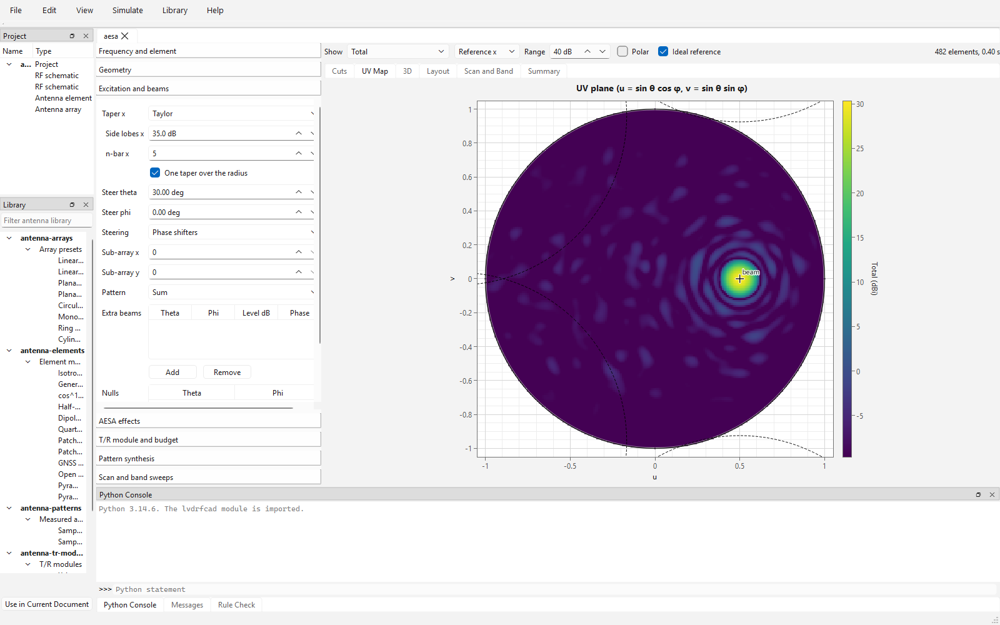

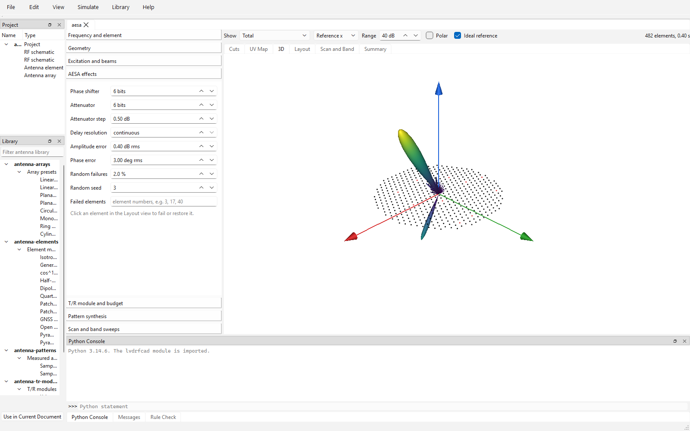

In the 3D view, drag to rotate, use the wheel to zoom, right-drag to pan, and double-click to reset the view.

### 16.5 How patterns are computed

The array pattern is the sum of the element patterns, each weighted by its excitation and the phase of its position. Rotated elements (cylinder, custom normals) are summed as vectors, so polarisation is correct on curved surfaces. Mutual coupling enters only through the element pattern: use a measured or simulated **embedded** element pattern for realistic scan behaviour. Analytic models are isolated elements.

- **Gain** is the embedded-element gain: efficiency × |Σ wₙ Eₙ|² / Σ |wₙ|². It contains the taper loss and the element scan loss. It is the quantity the EIRP and G/T use.
- **Integrated directivity** comes from integrating the pattern over the sphere. With well-matched elements at half-wavelength spacing it equals the gain divided by the efficiency. It is computed for arrays of up to 4096 elements.
- **Polarisation**: co- and cross-polar follow Ludwig's third definition. RHCP and LHCP follow the IEEE convention. The axial ratio is shown at the peak.

---

## 17. Beamforming, AESA effects and synthesis

### 17.1 Multiple beams and nulls

**Extra beams** (*Excitation and beams* page) add beams to the main one, each with a direction, a level and a phase; the weights are summed. **Nulls** force the array factor to zero in given directions. The weights are projected so that each null direction gets exactly zero, with the smallest possible change to the beam.

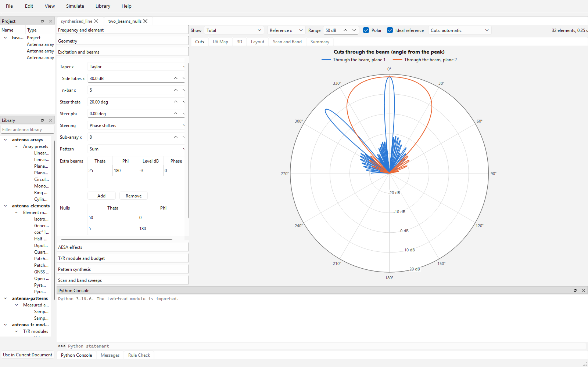

### 17.2 Monopulse

**Pattern** selects the sum beam or a difference pattern, *Difference, azimuth (x)* or *Difference, elevation (y)*: the two halves of the aperture are fed in antiphase. The difference pattern has a deep null at the steering direction. It uses the sum taper with the sign flipped (no Bayliss taper yet).

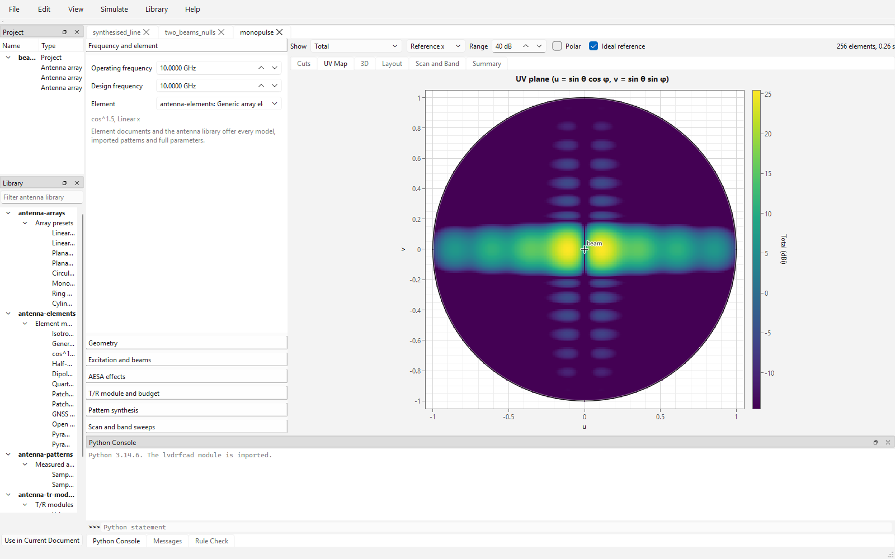

### 17.3 AESA effects

The *AESA effects* page models the T/R module hardware:

| Setting | Effect |
|---|---|
| Phase shifter bits | The phase that the delays do not provide is rounded to 360°/2^bits. The Summary reports the RMS quantisation error. |
| Attenuator bits and step | Amplitudes rounded to the step, at most (2^bits − 1) × step below the strongest element |
| Delay resolution | Time delays rounded to this step |
| Amplitude and phase error | Random Gaussian errors (RMS), the same for a given seed |
| Random failures and failed elements | Elements switched off. Element numbers start at 1; click elements in the Layout view. |

When any effect is set, the cuts also show the ideal array (dashed), so you can see the side-lobe floor rise and the beam move.

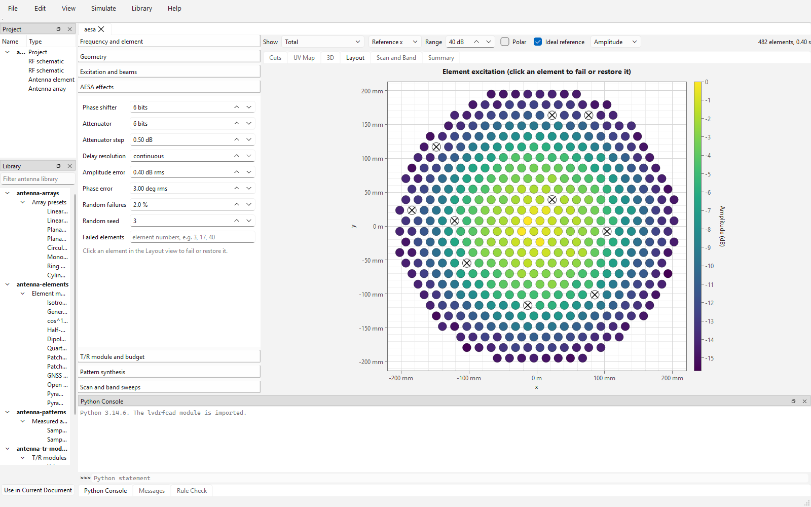

### 17.4 Grating lobes

A periodic lattice repeats the main beam in UV at the points of its reciprocal lattice. The UV map draws a unit circle around each of them (dashed). A grating lobe appears in visible space when the beam point lies inside a dashed circle, and the map marks it. The Summary gives the largest scan angle without grating lobes in the φ = 0 and φ = 90° planes. The scan sweep flags scan angles with a visible grating lobe.

| Lattice | Grating-lobe-free scan |
|---|---|
| Rectangular, spacing d | sin θ ≤ λ/d − 1 (0.5λ: to endfire; 0.6λ: 41.8°) |
| Equilateral triangular, spacing d | sin θ ≤ 2λ/(√3 d) − 1 in the worst plane, across the rows (0.6λ: 67.6°); along the rows to endfire |

### 17.5 Beam squint and true time delay

Phase shifters set for the design frequency steer correctly only at that frequency: at f the beam moves to sin θ = (f₀/f) sin θ₀. True time delay has no squint. Time delay per sub-array with phase shifters inside each sub-array removes most of it, at lower cost. The **Band** plot shows the squint across the band set on the *Scan and band sweeps* page.

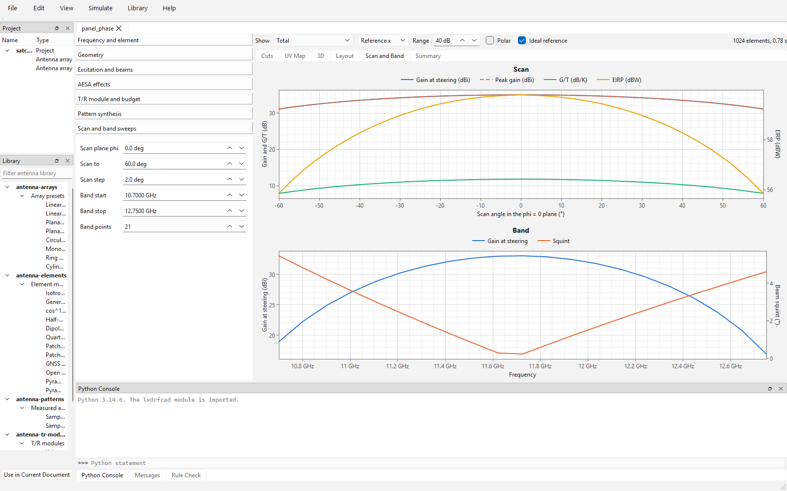

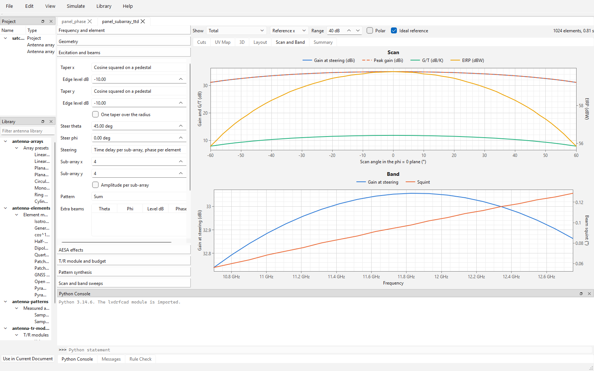

### 17.6 Pattern synthesis

The *Pattern synthesis* page finds element weights for a side-lobe mask:

- **Side-lobe mask**: the highest allowed level outside the main beam, relative to the peak.
- **Further steps**: lower levels further out, written `from deg:level dB`, for example `35:-40`.
- **Main-beam half width**: the region left free. With *automatic*, 1.5 beamwidths of the uniform aperture are left free.
- **Phase only**: keeps the amplitudes and changes only the phases. Useful for arrays with saturated amplifiers; much lower side lobes need amplitude control.

**Synthesise Weights** iterates (alternating projections with a least-squares step) and turns the result into the *Custom* taper. Steering is applied on top, so the synthesised shape follows the beam. Synthesis uses the array factor of the positions projected onto the xy-plane; for conformal arrays treat the result as a starting point.

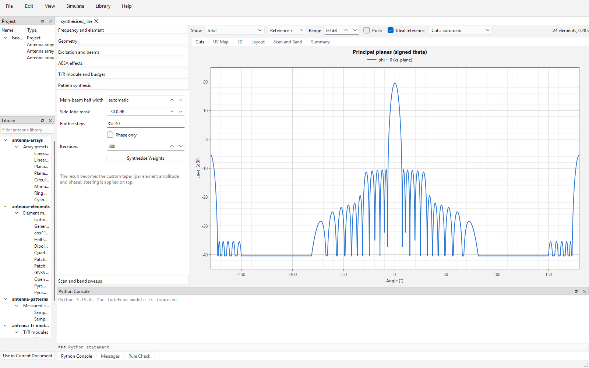

---

## 18. T/R modules, EIRP and G/T

The *T/R module and budget* page gives the transmit and receive values of one element's channel. Each side has one of three sources:

| Source | Values |
|---|---|
| Typed values | Output power and gain (transmit), gain and noise figure (receive) |
| Library preset | A T/R module of the antenna library |
| RF schematic budget | A live link to an RF schematic of the project. Its first budget analysis runs before every array result: the transmit power is the signal power at the chain's output, and the receive gain and noise figure are the cascade values. Edit the chain and the array follows. |

The page also sets:

- **Front-end loss**: between the T/R module and the radiator (radome, circulator, feed).
- **Beamformer loss**: the excess loss of the receive combiner after the LNA.
- **Antenna temperature**: the sky or scene seen by the array.
- **Ambient temperature**: the physical temperature of the lossy parts.

The note under the settings shows EIRP, G/T, system temperature and total PA power, and which values were used.

- **EIRP** = |Σ √Pₙ Eₙ|² towards the steering direction, with Pₙ the element power after the front-end loss. With every PA at full power (the default) and identical elements, EIRP = N² P G_element. *Transmit with the amplitude taper* scales the PA powers with the receive taper.
- **G/T** = G − L − 10 log T_sys, referred to the LNA input:
  - T_sys = T_ant/L + T_amb (1 − 1/L) + T₀ (F − 1)
  - F = F_TR + (L_BF − 1)/G_TR
  - G is the receive gain (with the taper loss), L the front-end loss, L_BF the beamformer loss.

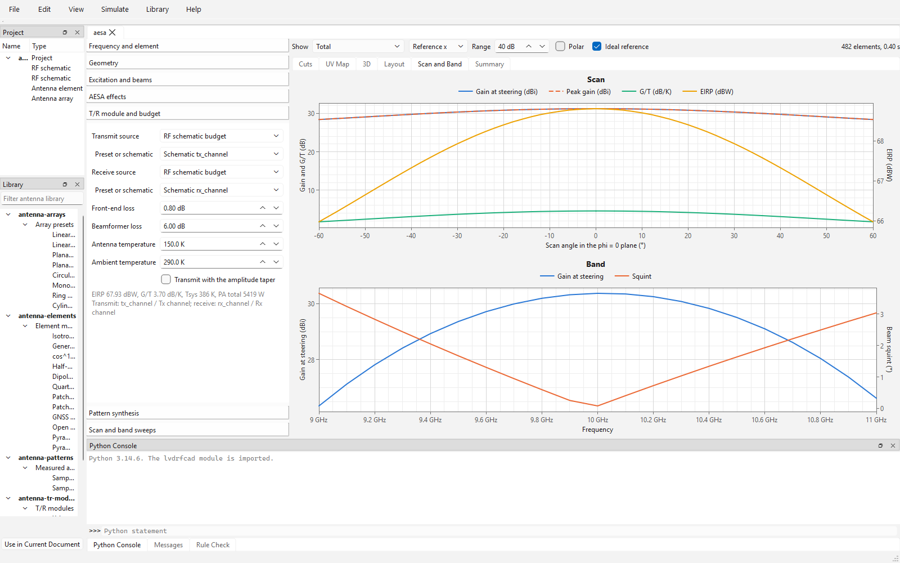

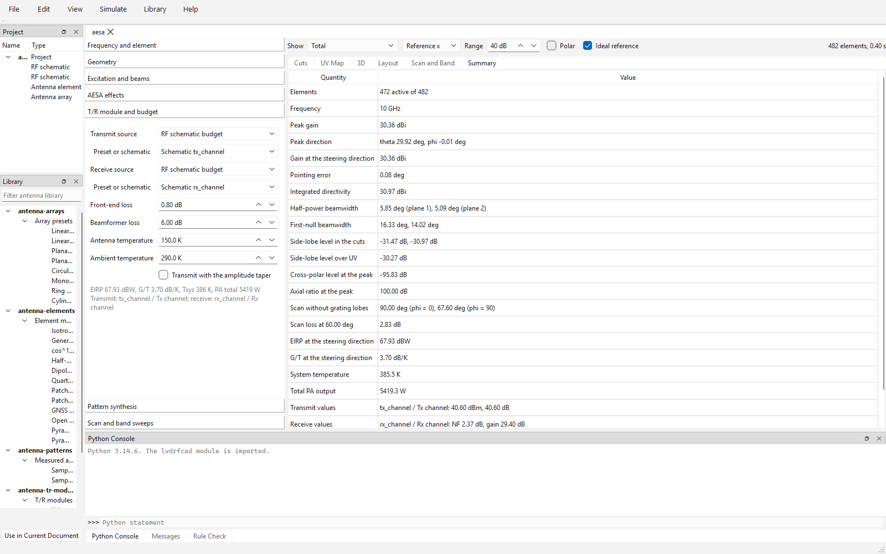

---

## 19. Python scripting

The **Python Console** at the bottom of the window runs Python commands; the `lvdrfcad` module is already imported. Scripts run without the window with the command-line program:

```
lvdrfcad-cli.exe my_script.py [arguments]
```

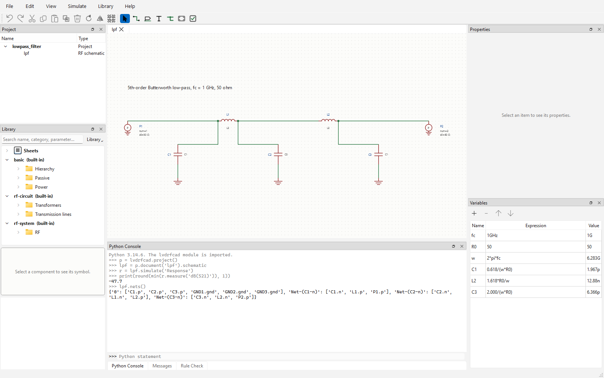

```python
import lvdrfcad

p = lvdrfcad.project()                       # the open project
lpf = p.document("lpf").schematic
r = lpf.simulate("Response")                  # a stored analysis
print(min(r.measure("dB(S21)")))
r.save_touchstone("lpf.s2p")

lpf.variables = {"fc": "2GHz", "R0": "50"}   # assign variables
lpf.set_parameter("C1", "c", "4.7pF")        # change a part
b = p.document("receiver").schematic.budget("Receiver budget")
print(b["stages"][-1]["cumulative_nf"])
```

SPICE schematics are scripted the same way:

```python
amp = p.document("amplifier").schematic
tran = amp.add_spice_analysis("tran", name="Step", stop="2ms", step="1us")
r = amp.spice(tran)                                   # runs ngspice
t, v = r.evaluate("v(out)")                           # a trace: x and values
print(max(v))
mc = amp.spice_monte_carlo([{"target": "R*.r", "tolerance": 0.01}],
                           [{"expression": "v(out)", "function": "max"}], runs=200)
print(mc["statistics"][0]["sigma"])
p.import_spice_netlist("old_design.cir")              # a netlist as a document
```

Antenna arrays and elements have their own objects:

```python
aesa = p.document("aesa").array                       # an antenna array document
aesa.update({"excitation": {"steerTheta": 40}})        # merge a partial design
aesa.use_library("antenna-tr-modules:x-gan-10w")       # a library entry
pattern = aesa.evaluate()                              # far field at the operating frequency
print(pattern.gain(40, 0), aesa.metrics()["side_lobe"])
print(aesa.budget()["eirp"], aesa.budget()["g_over_t"])
for point in aesa.scan():                              # scan loss, EIRP and G/T against scan angle
    print(point["scan"], point["gain"])
aesa.synthesise(sll=-35)                               # weights for a side-lobe mask
horn = p.new_document("antenna-element", "horn").element
horn.import_pattern("horn_measured.csv")
```

Changes from Python appear in the editor at once; schematic changes can be undone. The complete reference is `docs/python-api.md`; the example generators `tools/make_examples.py`, `tools/make_spice_examples.py` and `tools/make_antenna_examples.py` build whole projects from Python.

---

## 20. Examples

The examples are in the `examples` folder. Copy a folder before changing it.

### 20.1 Low-pass filter (`lowpass_filter`)

A 5th-order Butterworth low-pass filter at 1 GHz, built from the normalised prototype values g = 0.618, 1.618, 2.000, 1.618, 0.618. All component values are computed from the variables `fc` and `R0`.

1. Open **lpf** and run the **Response** analysis (Ctrl+R). |S21| is −3.01 dB at 1 GHz, as a Butterworth filter must be.
2. Add a trace `GD(S21)` in a new plot: the group delay peaks near the cut-off.
3. Change `fc` to `1.5GHz` and run again.
4. *Tune* `C1` and `L2` and watch the response; *Reset* afterwards.
5. Real capacitors come in standard values: select **C1**, type its evaluated value into the parameter, and use the **E** button to round it to E24. Run again to see the effect.

### 20.2 LNA input match (`lna_match`)

An amplifier described by a Touchstone file (`amp.s2p`, with noise parameters) and an input L-network of a shunt capacitor `Cin` and a series inductor `Lin`. The starting values are deliberately poor.

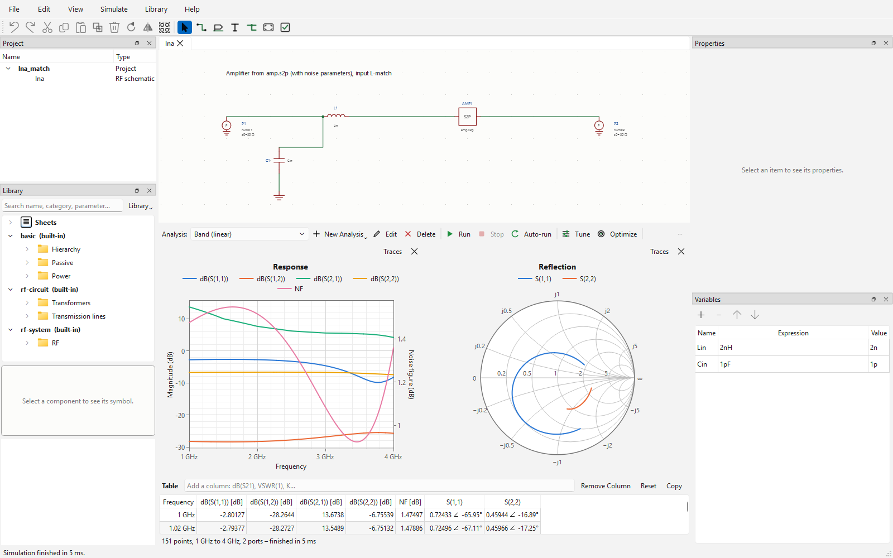

1. Open **lna** and run **Band**: |S11| is poor at 2.45 GHz.
2. *Simulate → Optimize…*: add `Lin` (0.3 nH to 30 nH) and `Cin` (0.1 pF to 20 pF), both rounded to E24, and the goal `dB(S11)` below −15 dB from 2.4 GHz to 2.5 GHz. Run, then *Apply* the rounded values.
3. Compare: |S11| now meets the goal. The noise figure changes too, because the source impedance seen by the amplifier changed; add `NFmin` to the plot to see how close to the minimum you are.
4. Try the matching tool: *Simulate → Matching Network Synthesis…* starts with the impedance seen at port 1.
5. Open `amp.s2p` with *File → Open Touchstone File…* to inspect the amplifier itself, including its stability factor K.

### 20.3 Superheterodyne receiver (`receiver`)

A 2.45 GHz receiver: antenna (150 K noise temperature), RF band-pass filter, LNA, mixer with a 2.38 GHz LO, a 70 MHz IF strip in a sub-sheet, and a 14-bit ADC sampling at 100 MS/s.

1. Open **receiver** and run **Receiver budget**.
2. **Budget** tab: cumulative gain about 35.5 dB and noise figure about 4 dB; SNR 21 dB for −90 dBm in 1 MHz.
3. **Frequency Plan**: 2.45 GHz → 70 MHz; the ADC aliases 70 MHz to 30 MHz.
4. **Spurs**: the image at 2.31 GHz is rejected by only about 27.5 dB by the 3rd-order RF filter. Raise the filter's `order` to 5 and run again to see the image rejection improve. The list also shows the half-IF response at 2.415 GHz and the LO leakage.
5. **Swept Budget**: the conversion gain follows the RF filter between 2.3 and 2.6 GHz.
6. Open **if_strip** to see the sub-sheet; on the top sheet the block's `gain` comes from the variable `if_gain`.
7. Increase the input power in the budget setup until stages are highlighted as compressed.

### 20.4 Up-converter (`upconverter`)

A user design: a 1 GHz signal is amplified, up-converted with a 15 GHz LO to 16 GHz, filtered, passed through a circulator (third port terminated, acting as an isolator), amplified and split to two outputs.

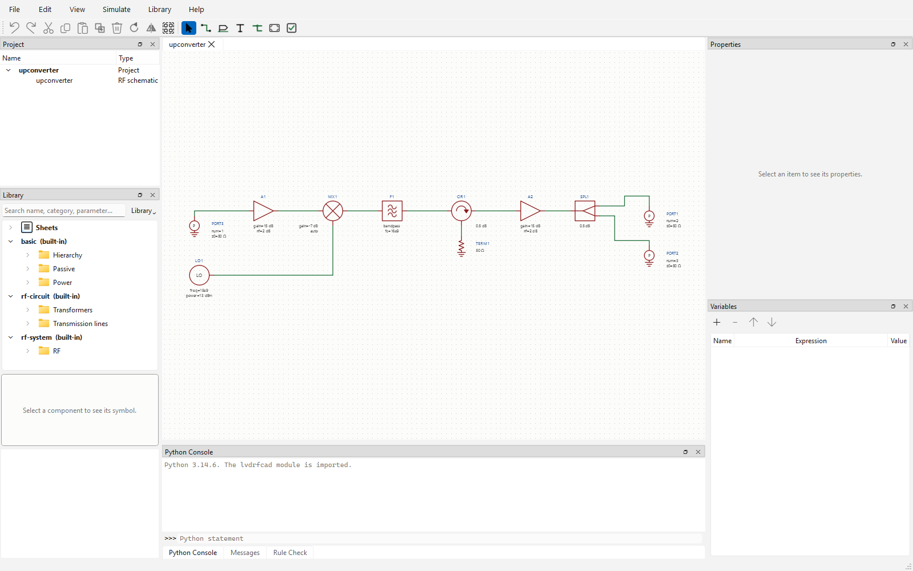

It shows several points made in this manual:

- **The mixer is mirrored**, so the signal enters at `if`; with `product` = `auto` and `side` = `low` this selects the sum product, 16 GHz. Setting `product` to `sum` gives the same result without mirroring ([10.3](#103-mixers-which-product-do-you-get)).
- **The input is a port** (PORT3, port number 1), so the budget setup gives the frequency (1 GHz) and power (+2 dBm) explicitly. The path is explicit too: `CIR1.p2` and `SPL1.out1` choose the circulator and splitter outputs.
- **Port numbers differ from the reference names**: PORT3 is port 1, PORT1 is port 2 and PORT2 is port 3, so S21 is from the input to PORT1.
- The **S-parameter analysis** gives the three-port match and the splitter isolation (S32); S21 and S31 cross the mixer and show only its leakage.

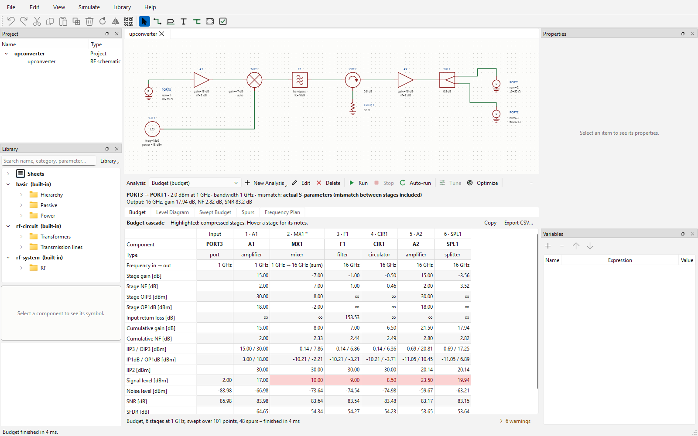

The budget reports the stages after the mixer as compressed: +2 dBm plus 15 dB gain gives +17 dBm at a mixer with an IIP3 of +15 dBm. Lower the input power in the budget setup (for example to −20 dBm) and run again: the warnings disappear.

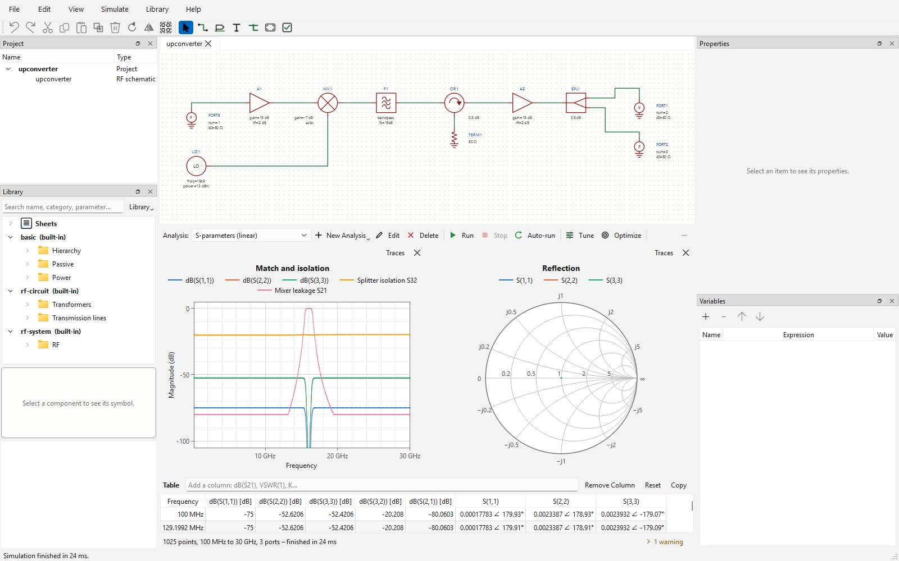

### 20.5 Op-amp amplifier (`opamp_amplifier`)

A non-inverting amplifier with gain 1 + RF/RG = 11 around a TL072-like op-amp on ±15 V, driven by a function generator (1 kHz, 0.2 V peak), with an oscilloscope on the input and output and a Bode plotter.

1. Open **amplifier** and run **Bias**: the output sits near 0 V; the supply currents and the op-amp's power appear on the schematic.
2. Run **Waveforms**, then open the **Instruments** tab: the scope shows 0.4 V and 4.4 V peak-to-peak at 1 kHz.
3. Run **Frequency response**: the Bode plotter shows 20.83 dB and the −3 dB frequency near 280 kHz (3 MHz gain-bandwidth / 11).
4. Run **Distortion**: the Values tab lists the harmonics of `v(out)`; THD is far below 0.1 %. Raise the generator's amplitude to 1.5 V and run again: the output clips at the rails and the THD rises.
5. *Sweeps & Statistics → Monte Carlo…* is already set up for 1 % resistors: the gain spreads by about 0.05 dB (σ). Type `db(v(out)/v(in))` into **Overlay** to see all responses.

### 20.6 Regulated supply (`power_supply`)

A 17 V peak, 50 Hz source, a 1N4007 half-wave rectifier, 2200 µF reservoir capacitor, a 7805 regulator and a 50 Ω load (100 mA), with ammeter, voltmeter and oscilloscope.

1. Open **supply** and run **Start-up and ripple** (200 ms).
2. **Instruments**: the scope shows the ripple at the regulator input (about 0.9 V peak-to-peak at 50 Hz) and the flat 5 V output; the ammeter reads 100 mA.
3. *Sweeps & Statistics → Parameter Sweep…* is set up for RL = 25, 50 and 100 Ω with the minimum input voltage as a measure: the valley drops to about 14.5 V at 200 mA. Lower `C1` until the valley comes within the regulator's 2 V dropout of the output, and watch the output ripple appear.

### 20.7 BJT amplifier (`bjt_amplifier`)

A common-emitter stage with a 2N3904, divider bias and an emitter resistor with bypass capacitor.

1. Open **common_emitter** and run **Bias**: the collector sits at about 5.7 V; the Values tab lists every current and power.
2. Run **Gain** (AC): about 46.5 dB mid-band. Its stored sweep runs the analysis at −40, 27 and 85 °C: the gain changes by about 2 dB.
3. Run **Noise**: the output noise density, and the totals in the Values tab.
4. Open **imported_netlist**: the same stage as a SPICE netlist (`reference.cir`) imported with *File → Import SPICE Netlist…*; its five analysis cards became analyses.

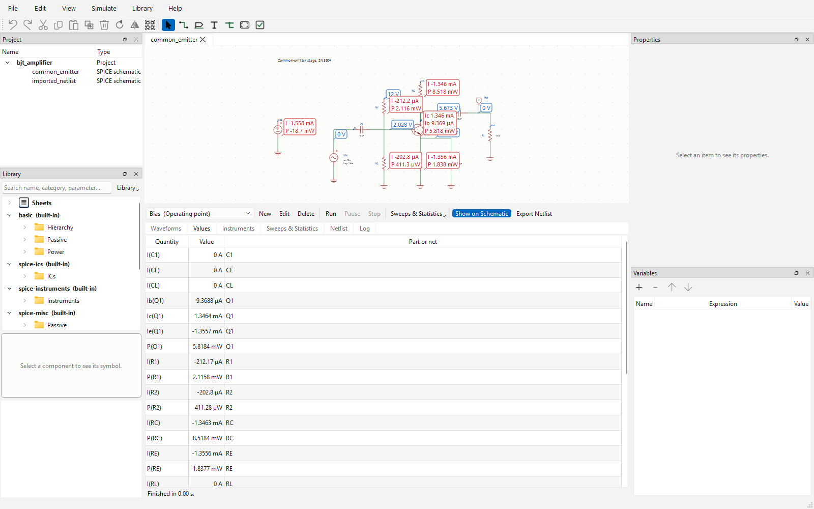

### 20.8 Op-amp stage with an RC low-pass (`opamp_filter`)

A user design: a sine source drives an ideal op-amp wired as a non-inverting amplifier with gain 2 (R2 = R3 = 1 kΩ), followed by an RC low-pass of R4 = 1 kΩ and C1 = 200 pF.

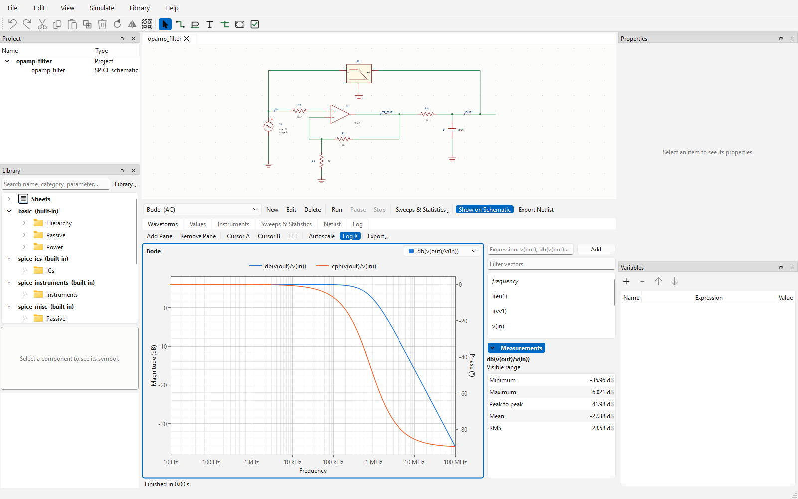

1. Open **opamp_filter** and run **Bode** (AC, 10 Hz to 100 MHz). The Waveforms pane shows `db(v(out)/v(in))` and, on the right axis, the phase `cph(v(out)/v(in))`: 6.02 dB at low frequency and −3 dB near 796 kHz = 1/(2π · R4 · C1), where the phase is −45°.
2. Run **Transfer function**: the DC gain is 2.000.
3. Run **Transient**: 5 ms of the 1 kHz, 1 V sine; the output is 2 V peak.
4. The Bode plotter **BP1** (`spice-instruments`) is connected to **IN** and **OUT**, with `ref` to ground: after running **Bode**, the **Instruments** tab shows the same gain and phase and reports the −3 dB frequency ([chapter 12](#12-virtual-instruments)).

An AC analysis needs a source with an AC magnitude; the sine source here has `ac` = 1 V by default.

### 20.9 X-band radar AESA (`aesa_radar`)

A 482-element array of 10 GHz patches on an equilateral triangular lattice (0.6λ) with a circular aperture and a radial Taylor taper (35 dB). Its T/R modules have 6-bit phase shifters and attenuators, 0.4 dB and 3° RMS errors, and 2 % failed elements. The transmit and receive values come from the RF schematics **tx_channel** and **rx_channel**.

1. Open **aesa**. The beam is steered to 30°: about 30.4 dBi, side lobes near −30 dB, EIRP about 68 dBW and G/T about 3.7 dB/K (Summary).
2. **Cuts**: the dashed traces are the ideal array; the errors and quantisation raise the far side lobes.
3. **UV Map**: the dashed grating-lobe circles stay outside the visible region; steer to 60° at φ = 90° and one comes close.
4. **Layout**: click a few elements to fail them and watch the side lobes.
5. Open **rx_channel**, raise the LNA noise figure by 1 dB, and return to **aesa**: G/T follows.
6. **Scan and Band**: scan loss about 2.8 dB at 60°; the phase-steered beam squints by about 3° at the band edges.

### 20.10 Ku-band satcom panel (`satcom_panel`)

Two copies of a 32 × 32 receive panel of RHCP elements at 11.7 GHz, steered to 45°. **panel_phase** uses phase shifters; **panel_subarray_ttd** uses time delay per 4 × 4 sub-array.

1. Open both and compare **Scan and Band**: the beam squints up to 5.5° over 10.7–12.75 GHz with phase shifters, and about 0.1° with sub-array delays.
2. Switch the component to **RHCP** and **LHCP**: the axial ratio at the peak is 0 dB (Summary).

### 20.11 Beamforming (`beamforming`)

1. **synthesised_line**: 24 elements synthesised to −30 dB side lobes, stepping to −40 dB beyond 35°. Change the mask on the *Pattern synthesis* page and press **Synthesise Weights**.
2. **two_beams_nulls**: a main beam at 20°, a second beam 3 dB lower at −25°, and nulls at 50° and −5°.
3. **monopulse**: the azimuth difference pattern of a 16 × 16 array; set **Pattern** to *Sum* to compare.

### 20.12 Element patterns (`element_patterns`)

Element documents for a 10 GHz patch, a dipole over ground, an L1 GNSS patch (RHCP) and a horn imported from a pattern file (**measured_horn**, synthetic sample data). Open each and compare the cuts, or use one as the element of a new array.

### 20.13 Horns: amplitude steering and amplitude-comparison DF (`horn_amplitude_steering`)

Ten 15 dBi horns at 17 GHz (the element document **horn**, a 35.3 × 27.1 mm aperture) point from −45° to +45° in 10° steps in the xz-plane. In **linear_fan** they stand on a line, 30 mm apart. In **arc_fan** they stand on an arc around a common centre 172 mm behind them, so that neighbours are also 30 mm apart. Both arrays use *Steering: None*, so the direction comes only from how the power is shared between the horns, set in the **Custom weights** table (*Excitation and beams* page, −100 dB = off). Both start with equal power in the 5° and 15° horns.

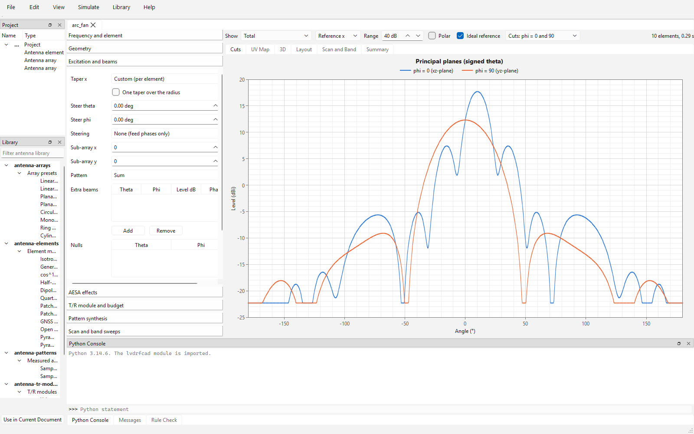

1. Open **arc_fan**: the beam is at 10°, between the two horns, at 17.7 dBi. Two horns around a common centre are in phase along their bisector, so the beam moves with the power ratio, from about 9° to 11°, and then jumps to the next horn's axis. With 10° between horns of about 30° beamwidth the pair pulls strongly towards the bisector.
2. Open **linear_fan**: with the same weights the beam stays near 2°. On a straight line the two coherent horns interfere and are in phase only straight ahead of the pair. Coherent amplitude steering needs a common phase centre, or a feed phase per horn.

   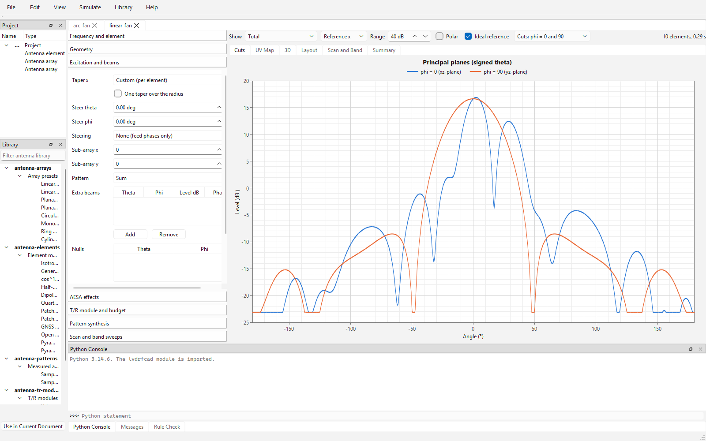

3. Change the weights, for example 0 dB on one horn and −100 dB on the others, to switch the beam from horn to horn in 10° steps (switched-beam control).
4. Run **amplitude_steering.py** in the Python console: `exec(open(r"<folder>/amplitude_steering.py").read())`. Without the window, use `lvdrfcad-cli amplitude_steering.py`. The script prints:
   - The beam direction against the power ratio, for both arrangements.
   - **Amplitude-comparison direction finding**. Each horn feeds its own receiver, so there is no interference, and the ratio of the powers received by the 5° and 15° horns gives the angle. The ratio changes by only about 0.22 dB per degree, because neighbouring horns overlap strongly, so a 1 dB channel imbalance moves the bearing by about 4.5°. Wider horn spacing (or narrower horns) makes the ratio steeper. This works with the horns on the line.

### 20.14 Circular arrays for direction finding (`circular_df`)

UHF (400 MHz) direction finding with quarter-wave monopoles (the element document **monopole**). The arrays open with the horizon cut in polar form.

1. **adcock_sum**, **adcock_ew**, **adcock_ns**: a four-element Adcock on a ring of 0.2λ radius, without steering. The sum is omnidirectional at the horizon. *Pattern* set to *Difference, azimuth (x)* gives the east-west pair, a figure eight along x; *Difference, elevation (y)* gives the north-south pair. These are the three channels of a Watson-Watt direction finder.

   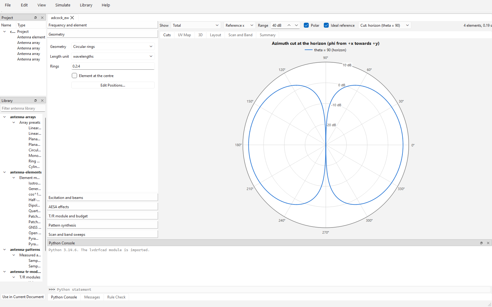

2. **uca8_beam**: eight monopoles on a ring of 0.5λ radius, phase-steered to the horizon (θ = 90°) at φ = 60°: 13.7 dBi towards 60° and side lobes near −8 dB. Change *Steer phi* to turn the beam round the horizon.

   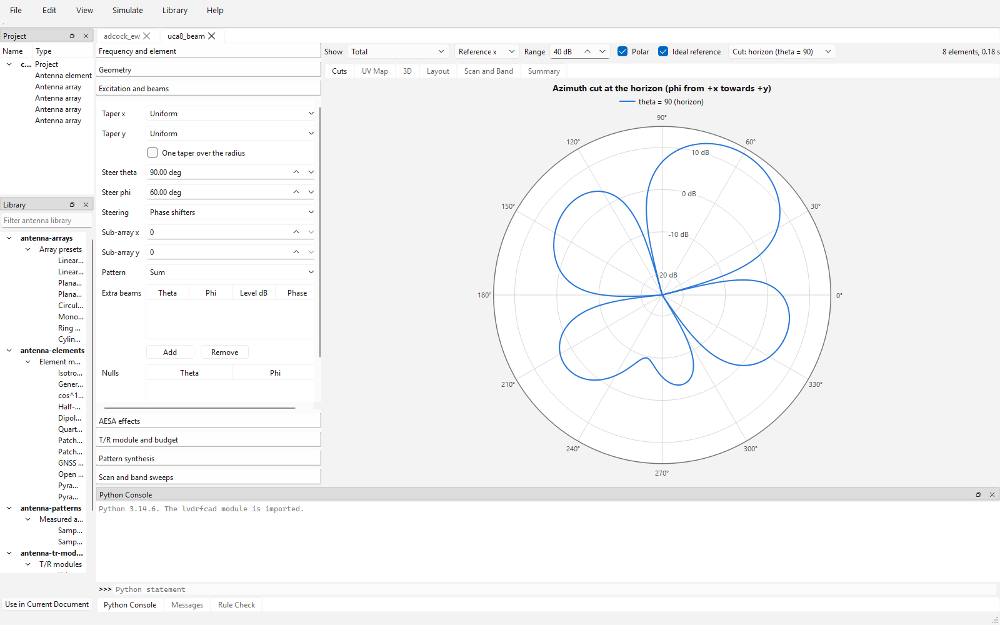

3. Run **df_demo.py** in the same way as 20.13. It prints:
   - The **Watson-Watt** bearing of the Adcock against the true bearing, from the difference channels relative to the sum. The error is the classic octantal spacing error, up to about 4° for a radius of 0.2λ; it is zero on the axes and diagonals. Make the radius smaller in all three documents and run the script again: the error falls.
   - A **beamscan** with the ring: the beam is steered round the horizon and the received power peaks at the two sources, 130° and 250° (6 dB weaker). With side lobes near −8 dB, weaker sources would be hidden by false peaks.

---

## 21. Troubleshooting

**The simulation does not start; the banner says "no simulation port".**
Place `rf-system:port` components. Sources and terminations are not ports.

**"port number 1 is used by …"**
Two ports have the same `num`. Give each a different number.

**Results look plausible but wrong.**
Run the rule check (Ctrl+E). A wire that ends near, but not on, a pin leaves the part floating. Ports and some blocks have their pin away from the symbol's centre: zoom in and check the end of each wire.

**S21 through a mixer is tiny.**
The S-parameter analysis does not convert frequency; across a mixer it only shows leakage. Use the budget (swept budget for gain versus frequency).

**The up-converter output is at f_LO − f_in instead of f_LO + f_in.**
Set the mixer's `product` parameter to `sum`. With `auto`, a signal entering at `rf` selects the difference product. See [10.3](#103-mixers-which-product-do-you-get).

**The budget says "set the input frequency".**
The chain starts at a port or an antenna. Enter the frequency and power in the budget setup, or start the chain at a source block.

**The budget follows the wrong branch.**
Give an explicit path and choose the exit pin at the branching component, such as `SPL1.out2`.

**A circulator or splitter port is left open.**
Terminate unused ports with `rf-system:termination`. An open port reflects all power; the rule check reports it.

**A library part shows "from cache" or "changed in library".**
The project was made with a library that is missing, or that has changed since. The stored copy is used; reinstall the library, or save to accept the current library version.

**The optimiser does not reach the goal.**
Check that the goal is physically possible, widen the variable ranges, add variables, or switch to Nelder–Mead.

**SPICE: "singular matrix" or "no DC path to ground".**
A node has no DC connection to ground: a capacitor in series without a resistor to ground, an open transformer winding, an unconnected pin. Add a large resistor (for example 1 GΩ) to ground, or connect the pin. The rule check finds unconnected pins.

**SPICE: "timestep too small" in a transient.**
The circuit switches faster than the simulator can follow, often with ideal switches or steep sources. Give sources a finite rise time, set a *Maximum step*, or add `reltol=1e-3` to the options.

**SPICE: "… has no SPICE model".**
The part comes from an RF library and has no SPICE model. Use the parts of the `spice-…` libraries, or add a `spice` model in the symbol editor.

**A trace shows "unknown vector".**
Node names are net labels in lower case: write `v(out)` for a net labelled `OUT`. Unnamed nets have generated names; give the net a label. Currents are written `i(V1)` with the reference of a voltage source (or an ammeter or current probe).

**An AC analysis shows only zeros.**
No source has an AC magnitude. Set `ac` on a source (or use the function generator, whose AC magnitude is 1 V).

**A model imported from a vendor does not run.**
Read the Log tab: the model may use syntax of another simulator. ngspice reads most standard `.model` and `.subckt` files, but some constructs specific to PSpice or LTspice have to be rewritten; encrypted models cannot be used at all.

**Antenna: "element document … not found" or "antenna library element … not found".**
The array refers to an element that was renamed or removed. Choose another element on the *Frequency and element* page.

**Antenna: a pattern file is rejected.**
The file needs a header line naming its columns (`theta`, `phi`, and gain or field columns). Data without a header must have exactly three columns: theta, phi, gain in dBi.

**Antenna: "the budget of … failed" or "has no budget analysis".**
A T/R side linked to an RF schematic needs a budget analysis in that schematic. Until it runs, the typed values are used; the warning is in the Summary.

**Antenna: the mask is not met after synthesis.**
The mask is too low for the number of elements, or the main-beam region is too narrow. Raise the level, widen the main beam, allow amplitude control (not *Phase only*), or raise the iterations.

**Antenna: the 3D view stays empty.**
The graphics driver offers no OpenGL. Update the driver; the other views work regardless.

---

## 22. Keyboard and mouse reference

| Key | Action |
|---|---|
| Ctrl+Shift+N, Ctrl+O | New project, open project |
| Ctrl+S, Ctrl+Shift+S | Save document, save all |
| Ctrl+Shift+O | Open Touchstone file |
| Ctrl+Z, Ctrl+Y | Undo, redo |
| Ctrl+X, Ctrl+C, Ctrl+V, Ctrl+D, Del | Cut, copy, paste, duplicate, delete |
| Ctrl+A | Select all |
| S, W, L, T, H | Select, wire, net label, text, net highlight tools |
| R, X | Rotate 90°, mirror |
| Arrows, Shift+arrows | Move the selection by 1 or 5 grid steps |
| Space or /, Backspace | While wiring: switch the corner, remove the last corner |
| Esc | Leave placement, wiring or paste |
| Home | Zoom to fit |
| Ctrl+E | Rule check |
| Ctrl+R | Run simulation (RF or SPICE, depending on the schematic) |
| Ctrl+Shift+R | Show or hide the results |
| F5, Shift+F5 | Run, stop (in the results area) |

| Mouse | Action |
|---|---|
| Wheel | Zoom at the cursor |
| Middle button drag, Space+drag | Pan |
| Drag on empty space | Rectangle selection |
| Ctrl+click on a wire or pin | Highlight the net |
| Double-click a label or text | Edit it |
| Double-click in a plot | Reset the zoom |
| 3D view: drag, wheel, right-drag, double-click | Rotate, zoom, pan, reset |
| Antenna Layout view: click an element | Fail or restore it |
